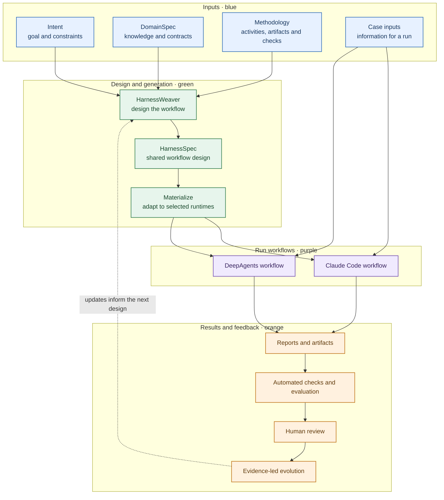

# HarnessWeaver architecture

HarnessWeaver turns a task and its domain method into runtime-specific agentic workflows. The overview below shows the main inputs, activities, outputs, and feedback loop.

## Reading the diagram

- **Blue inputs** describe the goal, domain, method, and case-specific information. The case input is supplied when running a workflow.
- **Green activities** turn those descriptions into a runtime-neutral `HarnessSpec`, then materialize it for the selected runtimes.
- **Purple workflows** execute the generated design using the native mechanisms of Claude Code or DeepAgents.
- **Orange results and feedback** collect artifacts, check them, involve a human reviewer, and use evidence to guide future changes.

The `HarnessSpec` is a shared design point; each runtime may realize parts of it differently. Evaluation-only reference data can be kept outside the run and made available only to the evaluator. A shared specification does not guarantee behavioral parity or prove that a workflow is complete or high quality.

HarnessWeaver is a research prototype. It does not automatically search for an optimal workflow. See the [ATAM pilot](pilots/atam/README.md) for a concrete example of the sources, case boundary, runtime forms, and validation steps.
