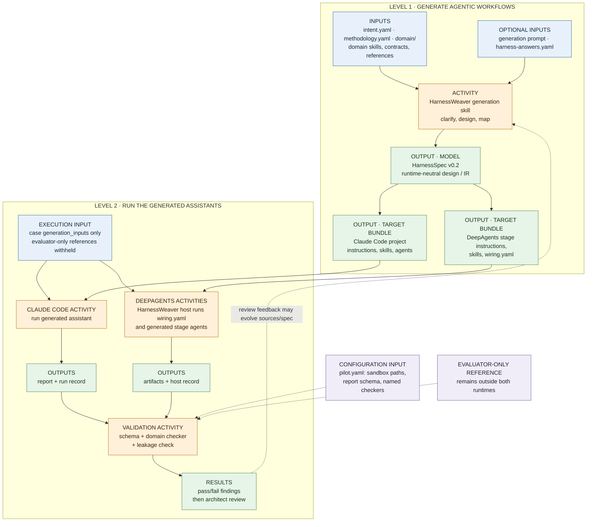

# HarnessWeaver: Towards Rapid Prototyping of Software Architecture Assistants

> **Working manuscript for co-author iteration.** Research-track short-paper draft (target: 5 pages + up to 2 pages of references). The current evidence is preliminary and does not support claims about speed, quality, equivalence, or generality. Text in square brackets is an editorial placeholder to resolve before submission. For double-anonymous review, add no author-identifying information to the manuscript or artifact links.

Overleaf import: [download the source ZIP](HarnessWeaver-CAIN-2027-Overleaf.zip). Rebuild it after editing the Markdown or LaTeX source with `python docs/cain-2027/package_overleaf.py` from the repository root. See [Overleaf instructions](OVERLEAF.md).

## Abstract

Software architecture assistants combine domain knowledge, methodological guidance, artifact contracts, and runtime-specific orchestration. Today, engineers commonly build such systems either as bespoke applications on agent frameworks or by manually specializing a general-purpose agent environment with skills, subagents, and orchestration. These approaches can require early commitment to an execution environment and make later changes to the method or runtime costly. This paper presents HarnessWeaver, a model-based approach for specifying and materializing domain-specific agentic workflows (LLM-based assistants). Its intermediate HarnessSpec makes intent, domain concepts, methodology, artifacts, semantic state, human review, and runtime requirements explicit; target-specific materializers use that specification to produce assistant workflows. A qualitative ATAM case explores this approach with Claude Code and DeepAgents. Both workflow bundles were run on the same case. The checked DeepAgents artifact passed the configured schema, ATAM, and reference-leakage checks after two human editorial corrections; the archived Claude Code result passed schema and leakage checks but failed the ATAM checker because scenario references did not match the source scenarios. These observations suggest that a shared specification can guide distinct runtime realizations, while also exposing mapping and parity questions. We describe the approach, preliminary evidence, threats to validity, and priorities for further evaluation.

**Index Terms—** AI engineering, agentic systems, software architecture, model-based engineering, multi-agent systems, agentic workflows.

## I. Introduction

Agentic software is increasingly used for work that extends beyond code generation, including research, analysis, and design. Engineering a useful domain-specific assistant requires more than a capable model: the system must encode a method, provide domain knowledge, manage intermediate artifacts and state, coordinate model calls, and enforce review or completion conditions. In software architecture, for example, an assistant may need to elicit drivers, analyze alternatives against scenarios, preserve evidence provenance, and leave decisions to an architect.

Two construction strategies are common. A team can implement a bespoke agentic application on a framework such as LangChain or LangGraph, directly encoding state, control flow, tools, and artifact handling. Alternatively, it can specialize a general-purpose harness by assembling skills, subagents, and orchestration patterns. The first offers implementation control but ties the method to application code. The second may reuse native harness capabilities, but still requires engineers to translate domain and methodological requirements into runtime-specific structures. In both cases, a team can commit early to a runtime and incur rework when the method or target environment changes.

This paper explores an intermediate engineering layer: **HarnessWeaver**. Authors describe the intended work, domain, methodology, artifacts, and constraints in runtime-independent sources. A coding agent uses these sources and generation skills to elaborate a HarnessSpec, then materializes one or more target-specific agentic workflows (LLM-based assistants). The specification makes the transition between authored intent and runtime realization inspectable and supports iterative design. The current approach does not search a design space for an optimal workflow, automatically learn a generator, or select a best runtime.

This paper offers three elements for discussion:

1. We describe a model-based approach for specifying domain-specific agentic workflows, keeping methodology state distinct from runtime execution state.
2. We outline target-specific materializations for Claude Code and DeepAgents, including orchestration and artifact contracts.
3. We present a qualitative ATAM case and discuss the validation and runtime-parity questions raised by its initial executions.

The paper is positioned as a new-idea and preliminary feasibility contribution. The CAIN 2027 short research category accommodates research-oriented position or new-idea papers that are not yet fully evaluated, with preliminary results appropriate to the format.

## II. Background and Related Approaches

### A. Methods encoded in multi-agent workflows

Multi-agent systems often encode a process through roles, prompts, and ordered or delegated tasks. MetaGPT, for example, uses software-development Standardized Operating Procedures (SOPs) to coordinate role-based agents and validate intermediate work [1]. This line of work demonstrates the value of making a workflow explicit within an agent system. HarnessWeaver shares the premise that method and intermediate artifacts matter, while focusing on an engineering representation that can be mapped to different harness technologies. Its methodology model describes activities, readiness, artifacts, semantic state, validation, and completion independently of a particular agent role or orchestration API.

### B. Specializing general-purpose harnesses

General-purpose coding and agent harnesses can be specialized through project instructions, skills, subagents, tools, and orchestration. The Revfactory `harness` project provides a close practical antecedent: its meta-skill designs domain-specific teams and skills, supports several execution patterns, and includes an evolution workflow [2]. Its companion study reports an author-run controlled experiment on 15 software-engineering tasks and argues that structured preconfiguration can improve agent output [3]. This supports the motivation for explicit harness configuration, but also leaves harness construction and adaptation as engineering work. HarnessWeaver builds on this lineage; its generation skills are derived from Revfactory/harness and should not be presented as wholly independent invention. Its focus is the shared intermediate specification and explicit mapping across runtime targets.

The Claude Code skills mechanism and the DeepAgents framework represent different ways to package specialized guidance and execution. DeepAgents supplies general-purpose capabilities such as planning, filesystem access, and subagent delegation [4]. HarnessWeaver uses these native capabilities as target mechanisms rather than attempting to replace them. The contribution under investigation is how domain and methodology descriptions can guide target-specific materialization while preserving a common source model.

### C. Domain-specific agentic workflows and harnesses

AutoOPT is a domain-specific workflow for optimization research. It combines numerical method design through BnB-PEP, LLM-based discovery of analytical descriptions and proofs, Lean 4 verification, and human interpretation; its authors report two case studies with machine-checked theorems [7]. AutoOPT shows how expert methodology can structure an LLM-based research assistant. HarnessWeaver addresses an adjacent engineering question: how to represent a domain workflow and materialize it for different runtime environments.

EvoSafeHarness is closer to harness synthesis. Given a frozen model and domain specification, it jointly evolves a natural-language safety policy and executable enforcement logic using behavioral feedback and adversarial review, and evaluates the resulting safety–utility trade-off [8]. Its objective is deployment-specific safety optimization. The present HarnessWeaver prototype instead describes and maps agentic workflows; it does not optimize policies or generate executable enforcement code. Together, these systems illustrate distinct meanings of “domain-specific harness” and motivate further work on the boundary between a workflow specification, its assistant realization, and the surrounding harness.

### D. Software architecture assistants

Prior work has explored LLM-based support for software architecture design and architecture exploration. Díaz-Pace et al. introduced ReArch for architecture exploration and reflection with LLM-based agents, using a textual description of a system and its requirements as inputs [5]. Cervantes et al. describe a broader, ADD-guided design process in which an LLM and architect persona produce an iteration plan and architecture document; they evaluate its outputs against a proven solution and through review by four professional architects [6]. These works illustrate agentic architecture exploration and end-to-end design workflows. HarnessWeaver addresses a complementary engineering concern: representing such domain methods independently of a runtime and materializing them as assistant workflows. SARA is a follow-up software-architecture-agent case study with a multi-stage design workflow. HarnessWeaver uses architecture evaluation as its initial case and prepares SARA as a possible second domain; SARA generation and execution are not yet part of the evidence reported here.

| Approach | Primary engineering unit | Runtime relationship | Relevance to this work |
|---|---|---|---|
| Bespoke agent application | Application code, state, and control flow | Usually chosen at implementation time | Direct control; often couples method to a host |
| Manual harness specialization | Skills, agents, tools, and orchestration | Native to a selected general harness | Reuses runtime capabilities; requires manual translation |
| MetaGPT / SOP-based systems | Roles and workflow procedures | Framework-specific realization | Makes process and intermediate work explicit |
| Revfactory/harness | Generation and evolution skill for Claude Code teams | Primarily Claude Code targets | Closest practical antecedent; source of design lineage |
| Better Together | ADD-guided architecture design process and artifacts | LLM with architect persona and human architects | Substantive architecture-design workflow; not a cross-runtime materializer |
| AutoOPT | Staged optimization-research workflow with numerical and formal tools | LLMs, BnB-PEP, Lean 4, and human review | Domain-specific research assistant; not a cross-runtime materializer |
| EvoSafeHarness | Model/domain-specific policy and code synthesis | Feedback-guided safety optimization | Close harness-synthesis work, with a safety objective |
| HarnessWeaver (proposed) | Runtime-independent workflow specification | Multiple target materializers | Separates authored method/domain model from assistant realization |

**Table I.** Comparison of construction approaches at the level relevant to this paper. The categories are intentionally broad; they do not imply that each prior system lacks internal abstractions.

## III. HarnessWeaver Approach

HarnessWeaver treats agentic-workflow construction as a model-to-realization process. Authors provide runtime-independent source material; a generation skill guides an interactive design process; the resulting HarnessSpec describes the intended workflow; target-specific materializers turn it into runtime-native assistant instructions and configuration; and bundle and execution checks provide feedback for revision.

**Figure 1. Two-level HarnessWeaver workflow.** Inputs, activities, outputs, and experiment configuration use distinct visual styles. The upper level produces a shared HarnessSpec and two target-specific workflow bundles from authored intent, methodology, and domain assets. The lower level runs each LLM-based assistant on the same case inputs and sends its outputs to validation. `pilot.yaml` configures the checks, while evaluator-only references remain outside both runtimes. Review feedback may inform later revision; the process does not automatically search for an optimal workflow.

### A. Sources and HarnessSpec

The authoring inputs distinguish three concerns. `IntentSpec` states the purpose, scope, exclusions, intended user, decision supported, and human-review requirements. `DomainSpec` describes relevant concepts and knowledge sources, portable skills, and artifact contracts. `Methodology` is a first-class model of activities, techniques, preconditions or readiness, produced artifacts, validation, semantic state, review points, and completion conditions. A versioned `HarnessSpec` brings these declarations together and adds roles, artifact ports, human gates, and runtime requirements for the intended workflow.

The specification is an intermediate representation (IR), not an executable model that determines every implementation detail. A target adapter maps the IR into runtime-specific files and orchestration. The materialization report records what was mapped, approximated, or unsupported. An evaluator/checker assesses the produced artifacts against declared contracts and case-specific criteria; it is distinct from a verifier that checks structural or provenance properties, and from a human domain expert who judges substantive conclusions.

The model separates **methodology state** from **runtime state**. Methodology state records domain progress—for example, whether architecture context is sufficient, scenario analysis is partial, or an architect has reviewed the report. Runtime state records execution facts such as active stage, retries, messages, and checkpoints. Completing a model call or stage is not evidence that a methodological activity is complete.

**Running example.** The ATAM workflow begins by establishing context: the assistant identifies system scope, business drivers, available architecture evidence, and open questions. The methodology declares that activity's readiness condition (`evaluation_inputs` are present), expected outputs, and evidence requirements. The context activity produces `01_context.json`; its outputs feed utility-tree construction (`02_utility_tree.json`), approach identification (`03_approaches.json`), scenario analysis (`04_analysis.json`), and report synthesis/review (`05_atam_report.json` and `06_review_findings.json`). HarnessWeaver represents these activities and handoffs in the methodology model and HarnessSpec; each runtime then expresses them using its own agent instructions and orchestration. This example follows the ATAM method itself rather than a particular system being evaluated.

### B. Runtime realization and orchestration

The current target mappings use two distinct runtime forms. The Claude Code materializer emits project instructions, skills, specialist agent definitions, and an orchestrator. The DeepAgents materializer emits stage directories containing agent instructions and skills, plus `wiring.yaml`; the HarnessWeaver host executes the wiring using DeepAgents-native agent, filesystem, and task mechanisms. Macro orchestration is declared in YAML, while the host supplies the execution loop. The outputs are runtime-specific agentic workflows, with inspectable instructions and configuration; they are not generated bespoke application implementations.

The mapping can use small orchestration primitives such as sequence, parallel work, delegation, and loops, then compile them into named patterns such as pipelines or fan-out/fan-in. The current ATAM DeepAgents profile is a sequential pipeline. The target runtimes need not have identical internal mechanics, but mappings should preserve declared method activities, artifacts, gates, and evidence rules. Runtime-specific deviations are reported rather than hidden.

For the ATAM context activity, the Claude Code workflow assigns the work to a context-analyst agent and passes its artifact to later specialists. The DeepAgents workflow represents the corresponding work as its first wired stage, producing the context artifact before subsequent stages run. In both realizations, the methodology's expected context outputs and evidence rules guide the activity; the target-specific agent instructions and orchestration differ. The observed difference is that Claude has a separate reviewer agent for final checking, whereas the current DeepAgents materialization performs review and revision tasks within one Stage 5 agent.

### C. Validation and evolution

Validation is layered: source and spec validation; bundle-structure checks; runtime execution; schema and domain-specific checks; reference-leakage checks; and human review. Results may trigger evolution of the authored method, domain material, specification, or target mapping. This is a guided engineering loop, not generator self-learning. The current prototype records generated files, checks, runtime records, and manual interventions to support later comparison.

HarnessWeaver also includes a separate `evolve` skill for using execution feedback to revise an existing workflow. It was not exercised in the ATAM runs reported here; the paper therefore makes no claim about how effectively it incorporates feedback or whether changes are preserved consistently across runtime targets.

For the context activity, validation checks that the expected context artifact conforms to its contract and that its methodology-state claims carry evidence. A completed runtime stage is not by itself proof that context is sufficient: that judgment must be supported by the artifact and its evidence. The checker can establish structural and configured rule-based properties, but a software architect must still assess whether the context is adequate for the evaluation.

## IV. Preliminary Feasibility Case: ATAM Architecture Evaluation

### A. Case and procedure

The qualitative evaluation instantiates a bounded ATAM architecture-evaluation workflow. Recent work also explores agentic automation of ATAM and SAAM for continuous architecture assessment [8]. Our case shares that domain, but examines a different question: how a workflow specification and shared methodological assets can guide materialization in two agent runtimes. It does not replicate or compare against that paper's 39-case dataset or its automated metrics. The generation sources include an intent file, a standalone ATAM methodology profile, domain skills, JSON artifact contracts, a report template, and recorded design answers. The banking architecture case is supplied only at execution time: its `evaluation_inputs` are available to the assistants, while evaluator-only reference outputs remain outside the runtime sandboxes and are reserved for the external checker. The running example in Section III follows the ATAM method, not details of this case system.

The methodology has five activities: establish context; build a utility tree; identify architectural approaches; analyze scenarios; and synthesize and review. It specifies intermediate artifacts and state, keeps observed evidence distinct from inference, records gaps, and requires architect review before decision use. A HarnessSpec v0.2 was elaborated from the shared source assets, then Claude Code and DeepAgents bundles were materialized. The generated Claude Code workflow uses specialist skills/agents with distinct synthesis, review, and revision stages. The DeepAgents workflow uses five sequential stages, with synthesis, review, and revision tasks in its final stage.

The ATAM workflow is represented as five activities: establish context; build a utility tree; identify architectural approaches; analyze scenarios; and synthesize and review. Their declared outputs become intermediate artifacts passed between target-specific assistant steps. The activity model also defines evidence rules, gap handling, and the distinction between runtime completion and methodological readiness. The case is used to exercise these artifacts and checks; we do not treat its architecture details as the conceptual example for the workflow model.

### B. Execution evidence

The recorded DeepAgents run completed all five stages with structured Pydantic outputs and no structural repair attempts. Its report contained 15 utility-tree scenarios, 15 analysis records, and five architectural approaches. The report remained a draft with architect review pending. After the run, a human corrected two evidence-related findings; the corrected artifact passed the report-schema, ATAM-pilot, and reference-leakage checks. The checked artifact therefore differs from the raw model output, as recorded in the host record and post-run revision note.

The Claude Code execution produced a draft report and completed its internal validation/revision workflow. However, the archived `hw check` record passed schema and reference-leakage checks but failed the ATAM pilot check: 19 analysis records referred to scenarios that the checker could not match to raw source scenarios. A subsequent internal validator summary reported zero failures and warnings, but that does not supersede the archived external check. The Claude result is therefore a generated execution with a known external validation failure, not a successful parity cell.

| Target | Execution result | External checks | Human intervention / qualification |
|---|---|---|---|
| DeepAgents | Five stages completed; report is a draft | Schema: pass; ATAM: pass; no leakage: pass | Two post-run editorial corrections; not an architect-approved evaluation |
| Claude Code | Workflow produced a draft report | Schema: pass; ATAM: fail; no leakage: pass | Scenario-reference matching failed; internal validation does not clear the external failure |

**Table II.** Current ATAM execution evidence. Checks establish conformance to configured rules, not substantive correctness or runtime equivalence.

### C. Preliminary interpretation

These observations are consistent with the possibility of using one set of domain and methodology sources to guide workflow materialization for two runtimes. They do not establish that the targets behave equivalently or that the generated workflows are complete. The Claude bundle's scenario references did not satisfy the external checker, while the DeepAgents artifact required editorial correction before it passed. The targets also differ in review independence and orchestration. A second domain, Architecture Design using SARA, has been prepared but has not yet been generated or run.

## V. Discussion and Research Agenda

We treat the case as a **qualitative, artifact-centered feasibility evaluation**, supplemented by deterministic checks. It is not a controlled comparison and does not test hypotheses about productivity or output quality. Instead of presenting formal research questions that the current evidence cannot answer, we use three evaluation questions to organize what the case can show:

- **EQ1—Specification-to-runtime feasibility:** What parts of the ATAM intent, methodology, artifact contracts, and evidence rules can be materialized and executed in each target?
- **EQ2—Reuse and target-specific work:** Which source assets remain shared, and what target-specific files, workflow adaptations, failures, or manual interventions appear?
- **EQ3—Method traceability:** How does the ATAM activity model connect readiness conditions, intermediate artifacts, evidence rules, and review state across the generated workflows?

The current evidence gives descriptive answers only. Both targets were generated from shared sources, but the archived Claude execution failed the external scenario-reference check, while the DeepAgents checked artifact included two post-run human corrections. The ATAM activity model and its artifacts make the intended workflow inspectable; these observations do not establish that generated assistants consistently follow it. SARA materialization is not included in this evaluation. Questions about development effort, adaptation effort, assistant quality, and evolution cost remain a **future empirical agenda** requiring repeated comparable tasks, explicit measures, and controlled recording of model, prompt, runtime, interventions, and artifacts. This agenda includes exercising the existing `evolve` skill: applying execution or review feedback to the workflow specification or its target-specific instructions, regenerating the assistants, and tracing which changes appear in subsequent artifacts and checks.

### Threats to Validity

**Construct validity.** Bundle checks and configured schema/domain checks provide evidence about structural conformance and selected ATAM rules. They do not directly measure methodological completeness, architect usefulness, or assistant quality. The DeepAgents artifact passed only after human corrections, and the Claude result failed scenario-reference validation; thus, the checker outcomes are imperfect proxies for overall workflow quality.

**Internal validity.** The runtimes used different models and orchestration strategies, and generation was interactive. These differences, together with manual corrections to the DeepAgents output, prevent attributing observed outcome differences to the shared specification or the runtime mapping alone. The available execution evidence is also limited to one recorded run per target.

**External validity.** The evaluation covers one methodology (ATAM), one architecture case, and two runtime technologies. The prepared SARA architecture-design workflow has not yet been generated or executed. The observations therefore may not generalize to other domains, methods, inputs, models, or runtime environments.

**Reliability.** LLM outputs and interactive generation can vary across runs and software versions. We preserve source and bundle records, prompts, check results, and manual interventions, but have not established repeatability across independent generations or executions.

The next evaluation should (1) fix the scenario-reference mapping upstream and regenerate or rerun Claude; (2) align or explicitly compare independent review and revision behavior across targets; (3) exercise the `evolve` skill and log the changes it proposes, applies, and preserves across targets; (4) log design and implementation effort and every manual intervention; (5) run the prepared SARA case if time permits; and (6) compare each result against a stable checklist of required activities, artifacts, evidence links, and human gates. No automatic optimal workflow discovery, broad design-space exploration, or generator learning is claimed.

## VI. Conclusion

HarnessWeaver is an exploratory model-based approach for describing domain-specific agentic workflows and materializing them as LLM-based assistants in different runtimes. In this pilot, one interactive generation session produced Claude Code and DeepAgents workflow prototypes from shared ATAM sources, suggesting a potentially lightweight path to multi-runtime prototyping; hands-on effort was not measured. Initial author review and source-based checking found the DeepAgents output to be a reasonable ATAM draft, and its corrected artifact passed the configured checks. The Claude execution also produced a draft and exposed a scenario-reference mismatch, while the DeepAgents result required two editorial corrections. Neither report has independent architect sign-off, and these observations do not constitute a controlled comparison of effort or assistant quality. Future work should evaluate the `evolve` skill by tracing how execution feedback changes the workflow specification and target instructions, and whether those changes carry into later runs. Whether these generated workflows should be understood as agent harnesses, and what properties would justify that classification, also remains open; clarifying this boundary is future work alongside broader evaluation of feasibility, reuse, effort, quality, and behavioral parity.

## References

[1] S. Hong et al., “MetaGPT: Meta Programming for A Multi-Agent Collaborative Framework,” in *Proc. International Conference on Learning Representations (ICLR)*, 2024.

[2] revfactory, “Harness: The Team-Architecture Factory for Claude Code,” project documentation and source repository, https://github.com/revfactory/harness. Accessed Oct. 27, 2026.

[3] M. Hwang, “Harness: Structured Pre-Configuration for Enhancing LLM Code Agent Output Quality—A Controlled Experiment with 15 Software Engineering Tasks,” manuscript, Mar. 2026. [Confirm publication status, version, and stable URL before submission.]

[4] LangChain, “Deep Agents: Open Source Agent Harness,” https://www.langchain.com/deep-agents. Accessed Oct. 27, 2026.

[5] J. A. Díaz-Pace, A. Tommasel, R. Capilla, and Y. E. Ramírez, “Architecture Exploration and Reflection meet LLM-based Agents,” in *Proc. 2025 IEEE International Conference on Software Architecture, New and Emerging Ideas Track (ICSA NEMI)*, 2025. Verify final proceedings metadata and page numbers before submission.

[6] H. Cervantes, R. Kazman, and Y. Cai, “Better Together: An LLM-assisted approach to designing software architectures using Attribute-Driven Design,” *IEEE Transactions on Software Engineering*, early access, pp. 1–17, June 23, 2026, doi:10.1109/TSE.2026.3706446.

[7] H. Kim, E. K. Ryu, and S. Das Gupta, “A Domain-Specific Harness for End-to-End Automation of Optimization Research,” arXiv:2608.07407, Aug. 2026.

[8] N. Li et al., “EvoSafeHarness: Evolving Model- and Domain-Specific Harnesses for Securing Agents,” arXiv:2609.05903v2, Oct. 2026.

[9] A. Kakran, S. Miryala, and K. Vaidhyanathan, “Agents as Architecture Evaluators: Automating ATAM and SAAM for Continuous Assessment,” in *Proc. ASE 2026 AgenticDev Workshop*, extended abstract, 2026, doi:10.1145/3843282.3844431.

## Editorial notes for the next iteration (remove before submission)

- Confirm the final CAIN template, anonymization, submission dates, and page accounting against the live call before moving to Overleaf. The draft is being prepared for the short-paper category.
- Replace the high-level related-work text with a focused literature review and finalize IEEE-formatted references. In particular, verify the Revfactory paper's publication status and the final ReArch proceedings metadata and page numbers.
- Decide whether to keep SARA as a future/pending case or omit it from the submitted version if not completed.
- Reconcile evidence after the next Claude run; the archived external check currently fails scenario-reference matching. Preserve historical results and report any regenerated run separately.
- Add a concise evidence/replication statement and an anonymized artifact link only after the artifact is curated and checked for identifying metadata.
- Figure 1 is written in Mermaid for iteration and will need conversion to a vector graphic for Overleaf. Table I and Table II may need reduction to meet the five-page body limit.
