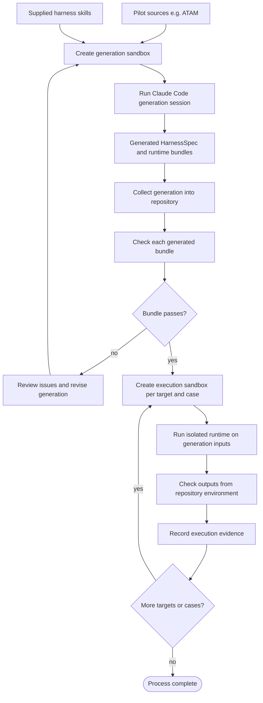

# Running HarnessWeaver sandboxes

This guide covers the generation and execution sandboxes used in the CAIN 2027 pilot. Run repository commands from the root of the `harness-weaver` checkout. Each sandbox prints its full path when created and contains a `RUNBOOK.md` with its specific inputs and commands.

## What the sandboxes do

- A **generation sandbox** gives Claude Code a copy of the pilot's authored sources and the selected harness design skill. Claude writes the generated project only under `generated/` in that sandbox.
- An **execution sandbox** gives one selected runtime a read-only generated bundle and one case's generation inputs. Evaluator-only answers are not copied in.
- `collect` copies generation output into the repository and checks the generated bundles. `check` checks an execution result from outside its sandbox; `record` copies its evidence into `docs/cain-2027/evidence/`.

Sandboxes default to a sibling directory beside the repository. Use `--root <directory>` to choose another location outside the repository.

## Set up a Python environment

Use a dedicated Conda environment, a virtual environment, or an existing environment of your choice. Install HarnessWeaver from the repository root so `hw` and the Rich-based console output are available.

New Conda environment:

```bash
conda create -n harnessweaver python=3.12 -y
conda activate harnessweaver
python -m pip install -e .
```

Virtual environment:

```bash
python3 -m venv "$HOME/.venvs/harnessweaver"
source "$HOME/.venvs/harnessweaver/bin/activate"
python -m pip install -e .
```

Existing environment: activate it and run `python -m pip install -e .`. For DeepAgents, install its optional packages too with `python -m pip install -e ".[deepagents]"`.

Run commands directly while the environment is active. Without activation, use Conda with output capture disabled, for example:

```bash
conda run -n harnessweaver --no-capture-output hw sandbox create-generation atam --arm harnessweaver
```

If the sandbox run is launched outside the active environment, set `HW_PYTHON` so the runner can display Rich progress. Example:

```bash
HW_PYTHON="conda run --no-capture-output -n harnessweaver python" ISOLATION=settings ./run.sh
```

## Claude Code authentication

Install and sign in to Claude Code using the Claude account associated with your subscription. [Anthropic's Claude Code setup guide](https://docs.anthropic.com/en/docs/claude-code/getting-started) covers Claude account sign-in for Pro or Max subscriptions. Confirm `claude` starts successfully in a normal terminal before entering a sandbox. Sandboxes use your saved Claude Code credentials; do not put credentials in the sandbox or repository.

The generated `run.sh` defaults to `ISOLATION=bare`, which excludes OAuth login and requires an API key. For a Claude subscription login, use `ISOLATION=settings ./run.sh`; the launcher loads the sandbox's project settings while retaining the CLI's saved sign-in. Project settings can allow your user-level `CLAUDE.md` to load, as described in the per-sandbox `RUNBOOK.md`.

## Workflow at a glance



The first sandbox is for **generation**. Each later sandbox independently runs one target on one case. Execution sandboxes receive the collected bundle and generation inputs; checking and evaluation happen outside them.

## General procedure

### 1. Create and run a generation sandbox

From the repository root, create a sandbox. Omit `--answers` to let the design skill ask questions live; the option applies only to the HarnessWeaver arm.

```bash
hw sandbox create-generation <pilot> --arm harnessweaver \
  --answers pilots/<pilot>/harness-answers.yaml
```

For a baseline comparison, use `--arm revfactory-en`; answer its questions live. The command prints a Rich summary with the next run command and sandbox `RUNBOOK.md` path. The sandbox path is also printed alone on standard output for scripts.

Change into the printed sandbox path, then run Claude with subscription OAuth:

```bash
cd "/path/printed/by/the-create-command"
ISOLATION=settings ./run.sh
```

The launcher prints the Claude session ID and, on completion or failure, records its start, finish, exit code, and status under `record/`. Generated files must stay under `generated/`. Exit Claude Code when generation is complete.

### 2. Collect and check generated bundles

From the repository root, choose a unique label:

```bash
hw sandbox collect "/path/to/generation-sandbox" --label <run-label>
```

Collection copies generated files to `pilots/<pilot>/generated/<run-label>/`, finds the Claude transcript, and structurally checks any `build/claude/` and `build/deepagents/` bundles. It prints a check table and copyable `create-execution` commands for passing bundles. Review failures or a missing transcript before proceeding.

### 3. Create and run an execution sandbox

Create one sandbox per runtime target and case. The creation command prints the sandbox path, explains its input boundary, and points to the sandbox-specific `RUNBOOK.md`.

#### Claude Code target (Claude subscription OAuth)

```bash
hw sandbox create-execution <pilot> \
  --target claude \
  --bundle pilots/<pilot>/generated/<run-label>/build/claude \
  --case <case>
```

Enter the printed path and run Claude Code with your saved subscription sign-in:

```bash
cd "/path/printed/by/the-create-command"
ISOLATION=settings ./run.sh
```

Claude execution displays readable progress in the terminal and preserves the complete JSONL event stream in `output/transcript.jsonl`. Its report is written under `output/` when generated. This flow uses Claude Code's OAuth sign-in and does not require an Anthropic API key.

#### DeepAgents target (model-provider credentials)

The DeepAgents host uses the Python environment where HarnessWeaver and its `deepagents` extra are installed. Activate that environment before creating and running the sandbox. It also needs credentials for the selected model provider. The ATAM bundle currently documents `openai:gpt-5.4-mini`, which requires `OPENAI_API_KEY`; Claude subscription OAuth does not authenticate this provider call.

```bash
conda activate harnessweaver   # or activate the environment where `.[deepagents]` is installed
export OPENAI_API_KEY="your-key"
hw sandbox create-execution <pilot> \
  --target deepagents \
  --bundle pilots/<pilot>/generated/<run-label>/build/deepagents \
  --case <case> \
  --model openai:gpt-5.4-mini
```

Enter the printed sandbox path and run:

```bash
cd "/path/printed/by/the-create-command"
./run.sh
```

The runner shows progress for each stage and writes `record/host-record.json`, artifacts under `workspace/artifacts/`, and the ATAM draft under `output/`. If you are not running from the activated environment, set `HW_PYTHON` to that environment's Python command as described in [Set up a Python environment](#set-up-a-python-environment). The final human-review gate is recorded by the host; it does not approve the report.

To retry a DeepAgents execution in the same sandbox, run `./run.sh --clean`. This deletes that run's `workspace/`, `output/`, `record/`, and `check.json`, then reruns every stage from Stage 1. It is a clean rerun, not a continuation of the previous model conversation. Without `--clean`, the launcher prevents a second attempt in the same directory. Claude execution uses a fixed Claude session and should use a fresh execution sandbox for another run.

DeepAgents uses Pydantic models derived from each declared JSON Schema. Single-artifact stages return one structured response; LangChain selects provider-native `ProviderStrategy` when supported and tool-based `ToolStrategy` otherwise. A stage with multiple artifacts receives a separate Pydantic-validated writer tool for each output, so it does not have to return a combined artifact envelope. The host validates all written files against the original JSON Schemas. If a stage fails structural validation, it gets one additional bounded repair attempt. If structured-response parsing fails but existing files pass the JSON Schemas, the host keeps the validated files and records a warning. The host does not pass ATAM evaluator or reference-leakage findings to the model. The stage record shows whether structured output was required and whether a repair was attempted.

### 4. Check and record execution evidence

From the repository root:

```bash
hw check "/path/to/execution-sandbox"
hw sandbox record "/path/to/execution-sandbox"
```

`check` reports schema, pilot-specific, and reference-leakage results and writes `check.json`. `record` copies the sandbox metadata, check result, output, intermediate artifacts, and runtime records into `docs/cain-2027/evidence/`. Use the check command even if the runner failed, to see which expected outputs are present.

Claude's launcher runs the external schema check after producing a report. If only JSON/schema conformance fails, it resumes the same Claude session for one constrained report repair and records the pre-repair check at `record/check-before-repair.json`. It does not send pilot-specific evaluator or leakage results to Claude. DeepAgents uses Pydantic structured output at generation time and retains the original JSON Schema validation afterward. Run `hw check` afterward and review the final `check.json` before recording. If you change the bundle or case inputs, create a new execution sandbox so its copied inputs stay aligned with the run.

## Current example: ATAM generation with OAuth

Create a new sandbox from the current pilot configuration. An older generation sandbox created before the standalone-configuration change has stale inputs.

```bash
hw sandbox create-generation atam \
  --arm harnessweaver \
  --answers pilots/atam/harness-answers.yaml
```

In the generated sandbox, run:

```bash
cd "/path/printed/by/the-create-command"
ISOLATION=settings ./run.sh
```

The sandbox has read-only ATAM sources and `harness-answers.yaml`; generated HarnessSpec, design notes, and runtime artifacts belong in `generated/`. It does not include banking case data or evaluator-only reference outputs.

When generation finishes, collect it from the repository root:

```bash
hw sandbox collect \
  "/path/to/generation-sandbox" \
  --label atam-hw-oauth-1
```

If the collection checks `build/claude/` successfully, create a Claude banking execution sandbox:

```bash
hw sandbox create-execution atam \
  --target claude \
  --bundle pilots/atam/generated/atam-hw-oauth-1/build/claude \
  --case banking
```

Then run Claude, check, and record:

```bash
cd "/path/printed/by/the-create-execution-command"
ISOLATION=settings ./run.sh
hw check "/path/to/execution-sandbox"
hw sandbox record "/path/to/execution-sandbox"
```

The sandbox receives `input/architecture-context.json` with only `evaluation_inputs`. `ground_truth_outputs` remain in the pilot case YAML for the external checker and are never copied into the sandbox.

To run the DeepAgents version instead, create a separate sandbox from the DeepAgents bundle using the instructions above. It requires model-provider credentials (the current bundle uses `OPENAI_API_KEY`), even if the Claude Code version ran successfully with subscription OAuth.

## Troubleshooting

- **Claude authentication failure or usage limit:** run `claude` in a normal terminal to confirm the saved login, then retry with `ISOLATION=settings ./run.sh`. If Claude reports the session is already in use or a reset time, wait for the reset and resume using the session ID recorded in `sandbox.yaml`/`record/`; do not launch a second process with the same session ID concurrently.
- **DeepAgents authentication failure:** confirm credentials exist for the model provider selected with `--model` (the current ATAM bundle uses `OPENAI_API_KEY` for `openai:gpt-5.4-mini`). Claude subscription OAuth is only used by Claude Code and does not supply these provider credentials.
- **`hw` command not found:** activate the Python environment with the editable install, or use `conda run -n <environment> --no-capture-output hw ...`.
- **Runner cannot import Rich:** activate the environment where HarnessWeaver is installed, or set `HW_PYTHON` to that environment's Python command.
- **No `finished-at.txt`:** newly created sandboxes write finish time and exit status even if Claude or a provider command fails. Older sandboxes have the earlier runner script and may not contain these markers; inspect their transcript and session record.
- **Sandbox already exists:** sandbox names include timestamps. Retry creation; do not reuse a sandbox whose inputs predate a configuration change.
- **Bundle check fails:** inspect the issues printed by `collect`, then review the generated bundle and materialization report before creating execution sandboxes.
- **Runtime reports JSON/schema errors:** the runtime gets at most one structural repair attempt. If validation still fails, inspect the host record, `check.json`, or Claude transcript, then create a new execution sandbox for another run. Evaluation failures require reviewing the output and methodology; the runtime is not given the evaluator's answer key.
- **No generated bundle:** `collect` can preserve generated files, but there is no runtime to execute until a target materialization exists.
