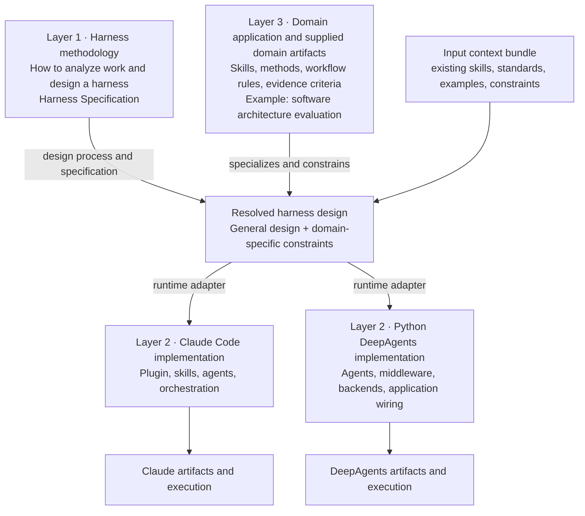
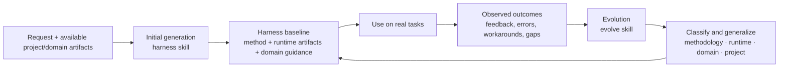
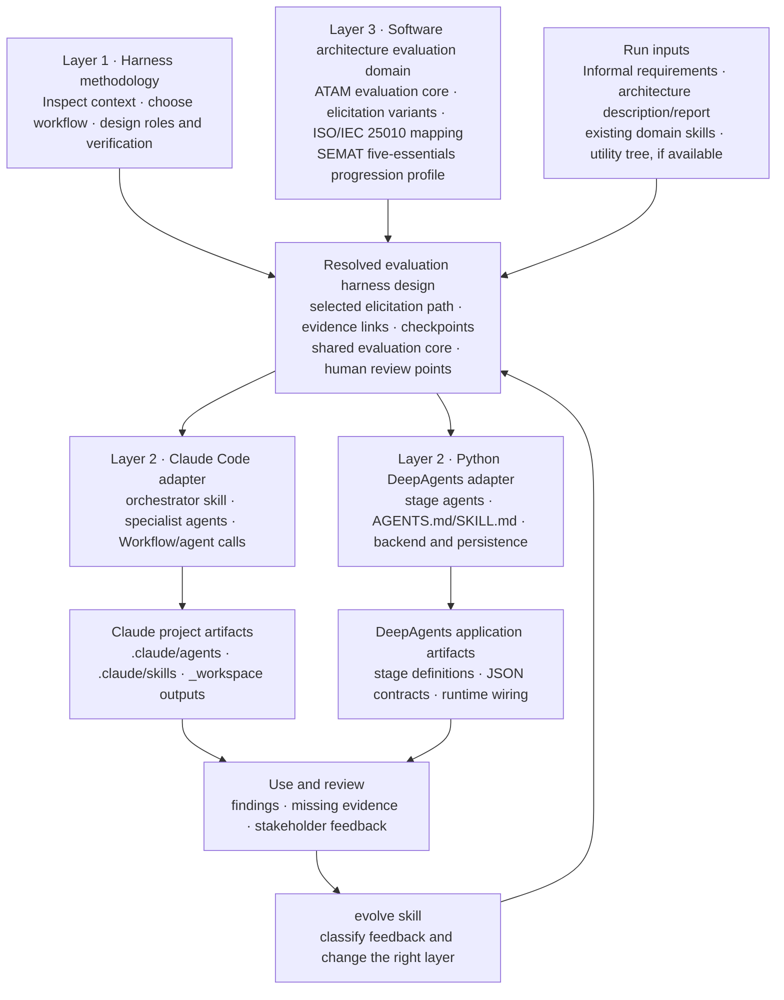

# Harness Consolidation: Analysis and Plan

**Status:** Current-state and target-architecture reference; HarnessSpec v0.1/v0.2 and the Python validator are established. The active repository layout was reconciled on 2026-10-18.  
**Date:** 2026-10-18

## Purpose

**Direction update (2026-10-18):** The product strategy and implementation sequence are authoritative in `STRATEGY.md` and `docs/harnessweaver-implementation-roadmap.md`. This consolidation document remains an architecture/reference proposal. Use **HarnessWeaver methodology** for the general process of designing a harness, and **domain methodology** for the process a generated harness carries out (for example, SAAM evaluation or architecture design exploration). The latter includes semantic progress and evidence, separate from agent and runtime state. A saved HarnessSpec is optional for a simple one-off. The [research-foundations note](research-foundations.md) records the paper evidence and its limits; HarnessWeaver is not currently an optimal-harness search system.

> Ownership update (2026-10-17): this repository document records intended boundaries. It does not transfer ownership of the separate case-study projects. Their content remains in place until provenance and ownership are explicitly established.

Consolidate the current repository into a coherent system for designing and implementing domain-specific agent harnesses. The system should support multiple runtimes, including Claude Code and Python-based DeepAgents applications, and should make domain applications such as software architecture explicit, reusable packages rather than examples mixed into runtime guidance.

The organizing principle is three layers:

1. **Methodology:** runtime-neutral guidance for analyzing a domain and designing a harness.
2. **Runtime implementations:** adapters and deliverables for particular agent runtimes, such as Claude Code skills and plugins or Python DeepAgents applications.
3. **Domain applications:** domain-specific methods and workflow-design constraints, plus reusable workflows, schemas, examples, and evaluation assets that can be implemented on one or more runtimes.

The boundaries matter: the general methodology defines how to design harnesses; a domain profile adds rules that follow from that field's accepted methods and evidence practices; a runtime implementation decides how those rules and workflow designs are represented and executed; a domain application supplies specialized knowledge and work products. Domain guidance may constrain the design of an agentic workflow without becoming runtime-specific. Domain knowledge may arrive as prose, standards, examples, existing agent/skill files, or a mix of these; the factory should inspect and selectively incorporate supplied artifacts rather than assume all domain guidance must be authored from scratch.



Layer 1 and Layer 3 both inform the design; neither is a runtime adapter. Layer 2 implements the resolved design, with each adapter documenting any capability gaps or adaptations.

The intended input model is evolving from **prompt-only** toward **context-and-artifact-driven**. A one-sentence request remains a supported lightweight entry point. In the normal case, the factory should also inspect whatever relevant materials the user or project already has—for example domain skills, reference documents, sample inputs/outputs, policies, existing agents, or an application schema—and use them to ground the design. This does not require a rigid intake form or a complete artifact bundle; the bundle is an input to the three layers, not a fourth layer.

## Harness lifecycle: generate, then evolve

The overall process has two connected parts:

1. **Initial generation (`harness`):** use the request and available context to create or revise a first usable harness for the selected domain and runtime. The output is a baseline, with its assumptions, source guidance, and intended use visible.
2. **Evolution (`evolve`):** after the harness is used, turn observed results and user feedback into targeted improvements to that baseline. Route each change to the layer it belongs to: general design methodology, runtime adapter, domain guidance/skill, or a project-specific harness artifact.



Evolution should be **incremental and evidence-led**, not a mandatory ceremony. A small correction can be applied directly with its reason recorded. Broader or repeated feedback may justify a short retrospective and a generalized change. Preserve supplied domain guidance; improve or version it only when evidence supports a change. Do not turn one-off preferences into universal rules without a reason.

### Middle-ground intake: progressive, evidence-led, and lightweight

Use a **progressive intake**: begin with what the user gives, inspect what is readily available, then ask only for decisions that materially change the harness. This avoids both designing from an underspecified sentence alone and making the user complete a large requirements package before useful work can begin.

| Intake depth | When to use it | What happens |
|---|---|---|
| **Quick start** | The user gives a short request and the task is familiar, bounded, or low consequence. | Infer a reasonable initial design, inspect the project context when available, state key assumptions, and proceed. Keep the output small. |
| **Context-assisted (default)** | Relevant project files or domain materials are present or easy for the user to point to. | Read existing harnesses, skills, domain references, examples, schemas, and constraints. Reuse applicable guidance and surface gaps or conflicts. Ask a short, grouped set of questions only for consequential unknowns. |
| **Structured discovery** | The workflow is broad, high consequence, methodologically ambiguous, tightly integrated with downstream software, or based on conflicting source material. | Create a concise design brief or artifact map before generation. Define only the stages, contracts, evidence rules, and decisions needed to build and evaluate this harness. Expand into formal schemas only when consumers need them. |

The normal interaction can be kept to five moves:

1. **Receive the request.** Accept a sentence, a fuller description, or a request to adapt existing materials; do not require a fixed prompt template.
2. **Inspect context.** Look at the relevant project tree and provided artifacts. For each supplied skill or guide, identify its purpose, scope, prerequisites, and relationship to the requested work.
3. **Separate knowns from decisions.** Record what is supported by evidence, what can be safely assumed, and which unknowns would change roles, workflow, output contracts, or human review.
4. **Ask once where practical.** Bundle the material unresolved choices into a concise clarification. If the remaining uncertainty is low impact, proceed with stated assumptions instead of asking.
5. **Confirm a compact design brief.** Summarize the goal, sources to reuse, proposed workflow/mode, expected outputs, and any assumptions or unresolved risks. Let the user correct material misunderstandings, then generate the harness.

The brief is a working checkpoint, not a new mandatory specification format. For a small harness it may be a few bullets in the conversation; for a complex workflow it may be a short Markdown artifact. Do not produce a formal schema, exhaustive traceability matrix, or full domain model unless it supports implementation, review, or downstream integration.

Scale the work to the task. A small workflow can use one orchestrator skill and a few well-scoped procedures. Add agents, multiple artifacts, workflow code, state tracking, or separate verification stages only when parallelism, evidence traceability, repeatability, risk, or integration needs justify them. The domain profile may establish non-negotiable requirements, but it should still allow the lightest implementation that satisfies them.

## Current-state analysis

### Ownership and source-of-truth inventory

| Area | Current location | Evidence and source of truth | HarnessWeaver boundary |
|---|---|---|---|
| Roadmap and project contracts | `docs/` | Root HarnessWeaver working tree | Canonical for project sequencing and shared contract decisions. |
| Harness and evolve skills (DeepAgents target inside harness) | `src/harnessweaver/skills/` | Active skill tree in this checkout; no root `skills/` or `packages/harness-en/` copy is maintained here | Canonical HarnessWeaver skill source. README install paths point into this tree; keep shared design guidance separate from runtime-specific output and report adapter limits. |
| HarnessSpec and pilots | `specs/`, `pilots/` | HarnessWeaver-owned additions | Canonical shared contract and consumer fixtures. |
| Python core | `src/harnessweaver/` | HarnessWeaver-owned additions | Runtime-independent loading and validation only in the first deliverable. |
| ArchEval | `case-studies/architecture-eval/` | Separate Git repository at `main`; this worktree currently reports `origin/main`; project README identifies it as the ArchEval replication package | Preserve source, research inputs, ground truth, and outputs. HarnessWeaver may reference the ATAM workflow and data. The local Git metadata did not expose a remote URL in this inventory. |
| ATAM LLM evaluation kit | `case-studies/atam-evaluator/archevaluation-llms/` | Nested Git checkout; `origin` is `andresdp/archevaluation-llms` | Preserve prompts, PDFs, and research records; use only as a separate portability case. |
| Software architecture agent | `case-studies/software-architecture-agent/` | Nested Git checkout; `origin` is `NicolasMP51/software-architecture-agent` | Preserve application history and wiring; integration changes require its owner/provenance decision. |

The outer worktree currently has only `README.md` tracked by Git; many docs, skills, package files, and case-study trees appear as local untracked content. Do not infer that untracked means disposable or HarnessWeaver-owned. Keep case-study files unchanged during the initial contract work. The exact license/author attribution for the ArchEval tree and owners of the other nested projects still need confirmation before any consolidation or edits.

Suggested change routing: shared methodology and project boundaries go in `docs/`; contract/schema changes go in `specs/`; loaders, validators, and runtime-neutral CLI behavior go in `src/harnessweaver/`; runtime output belongs under a future adapter; domain-specific ATAM rules belong in a HarnessWeaver-owned domain package that references rather than copies case-study evidence; standalone applications and research repositories retain their own source and provenance.

### What already exists

- `src/harnessweaver/skills/harness/` and `src/harnessweaver/skills/evolve/` are the active skills in this checkout. Together with their references, they contain the harness design and evolution methods. Their content still includes Claude Code-specific paths and capabilities that need to be identified and bounded.
- The `evolve` skill already provides the second lifecycle capability: it collects differences between the initial and current harness, classifies feedback, generalizes and applies changes, records history, and reports the update. Its current file conventions are Claude-oriented, so consolidation should preserve its portable feedback method while separating runtime-specific paths and update mechanics.
- The current Harness skill already audits existing `.claude/agents/`, `.claude/skills/`, and `CLAUDE.md`, analyzes the codebase, and checks for duplicate agents/skills before generating them. The proposed shift extends this behavior: supplied domain-methodology skills and other source artifacts become normal inputs even when they are not already installed in those Harness-specific locations.
- `src/harnessweaver/skills/harness/references/targets/deepagents.md` (formerly the `deepagents-port` skill) defines the DeepAgents mapping workflow. It uses a staged agent/skill/JSON-artifact pattern and records fidelity limits; the current skill does not itself wire a target application's Python backend.
- `software-architecture-agent/` is an ignored nested application with a four-stage software-architecture workflow, DeepAgents backend, React frontend, and Firestore artifacts. Its stage instructions are a concrete software-architecture domain application, but its runtime wiring and domain methodology currently live together in this separate application.
- `atam-evaluator/` is a separate evaluation/research bundle focused on ATAM prompts, example results, and source artifacts. It can inform a software-architecture domain package and its evaluation approach, but it is not itself part of the general harness methodology.
- `atam-evaluator/applsci-16-03020-v3.pdf` provides a complementary software-architecture-evaluation practice model. It identifies five evaluation essentials—Architecture Description, Quality Attributes, Business Goals, Architecture Decisions, and Evaluation Adoption—and represents their healthy progression as states with checklists. Its domain guidance should inform how an architecture-evaluation workflow is designed and assessed, not be flattened into generic harness rules.
- Root docs explain the upstream Claude plugin, this checkout's skills, manual installation, migration, and examples. The active skill sources are in `src/harnessweaver/skills/`; installation and ownership references should point there. Product, distribution, methodology, and runtime assumptions also overlap across README and skill content.
- `docs/harness-100-prompts_EN.md` already contains examples for two related but distinct software-architecture workflows: a four-stage architecture decision pipeline (Appendix A) and ATAM architecture evaluation, including elicitation variants and practitioner versus research modes (Appendix B). These are prompt/specification examples, not yet canonical domain packages or verified runtime implementations, and should be reconciled with the proposed profile rather than duplicated.
- The cookbook describes its ATAM evaluation corpus as eight anonymized reports, but the current `atam-evaluator/archevaluation-llms/input-artifacts/` inventory contains seven PDFs (G1–G4 and G6–G8). Confirm whether G5 is intentionally absent or missing before treating the local bundle as the full evaluation corpus.

### Main consolidation issues

1. **The current skill tree needs a clear portability boundary.** `src/harnessweaver/skills/` is the active skill tree in this checkout, but it still contains Claude Code conventions alongside general harness-design guidance. Its synchronization and release relationship to the upstream project remains to be verified.
2. **Runtime concepts are embedded in methodology.** Claude-specific paths, tools, model names, and orchestration behavior appear in the factory guidance. The skill package can be loaded by other agents, but that does not make these runtime instructions portable.
3. **The current audit is harness-centered.** It checks existing generated agents and skills, but the richer context-driven process should also inspect user-supplied domain skills, research, standards, examples, and schemas. Keep the one-sentence prompt as a fast path.
4. **The DeepAgents path is a port, not a peer implementation.** It starts from a Claude-designed harness and translates it to one fixed stage-oriented pattern. It is not yet a general runtime adapter that consumes a runtime-neutral harness specification.
5. **Domain application and runtime implementation are entangled.** The software-architecture app includes domain stage definitions alongside Python/Firestore wiring and a frontend. It is not a cleanly reusable domain package.
6. **External provenance remains incomplete.** This checkout has one active skill tree, but its exact release/synchronization relationship to the upstream project has not been established. The standalone case studies also retain their own ownership and provenance boundaries.
7. **The current software-architecture app has a Stage 1 call mismatch.** `build_stage1_message(user_id, project_id)` is called without `user_id` through `get_stage_message` and `PipelineService.run_stage`. Treat the app as an in-progress reference until its contract and execution path are reconciled.

## Target architecture

### Layer 1 — Methodology core

This layer defines the concepts and decision process without assuming a particular agent runtime or domain. It should cover:

- Harness intake and audit: user goals, existing assets, supplied context artifacts, constraints, and maintenance versus new-build routing.
- Domain and workflow analysis: tasks, inputs, outputs, control flow, uncertainty, evidence needs, and quality risks.
- Artifact-led construction: inspect supplied domain skills and references, identify their purpose and authority, resolve gaps or conflicts with the user/project context, and reuse or adapt relevant guidance.
- Harness design: roles, skills, orchestration, boundaries, handoffs, failure handling, and human decision points.
- Reuse and progressive disclosure: keep shared methods generic and load domain guidance only when relevant.
- Verification and evaluation: artifact completeness, task scenarios, quality measures, and evolution from feedback.
- Lifecycle support: distinguish creating an initial harness from improving it after observed use, and define how learning is routed to the correct layer.
- A runtime-neutral **Harness Specification** describing the design decisions that runtime adapters need.

The specification should be versioned and machine-readable where useful, but should not encode one runtime's syntax. It can begin as a documented schema plus examples before automation is added. Candidate fields include domain, workflow stages, agent roles, skill references, source-artifact references/provenance, handoff artifacts, execution constraints, verification rules, human gates, model requirements, and output contracts.

Keep this layer lightweight. Do not require every user to prepare a formal specification or every harness to emit a large model. Start from the available context, ask only for missing decisions that materially affect the result, preserve source references for reused guidance, and produce the smallest design record that lets a runtime adapter implement and maintain the harness. Formal schemas and exhaustive traceability are appropriate when an application, evaluation method, or downstream consumer needs them; otherwise, concise Markdown and a small artifact manifest are enough.

### Layer 2 — Runtime implementations

Each runtime implementation consumes the methodology and Harness Specification, then emits or executes artifacts using that runtime's supported conventions.

**Claude Code implementation**

- Generate a project-local **Claude Code harness** by default: `.claude/agents/`, `.claude/skills/`, Claude orchestration instructions, and a `CLAUDE.md` pointer. These artifacts are not automatically a Claude Code plugin.
- Treat a **Claude Code plugin** as an optional packaging and distribution form for a reusable harness. Plugin components use the plugin-root layout (such as `skills/` and `agents/`); `.claude-plugin/plugin.json` provides explicit identity and metadata, but current local loading can infer a name when the manifest is absent. A marketplace listing is a separate catalog/distribution step. The current Harness repository is itself an example of a plugin that distributes the factory skill; that does not make every harness the factory generates a plugin.
- Claude-specific capabilities, model identifiers, tool constraints, and validation guidance belong here.
- The existing marketplace can remain a distribution option for the factory plugin. Generated project-local harnesses can be used directly, or packaged as plugins when reuse/distribution calls for it. Standalone Agent Skills files can also be published separately where runtime compatibility is supported.

**Python DeepAgents implementation**

- Python application wiring, stage/agent factories, backends, persistence, API integration, and runtime-specific configuration.
- DeepAgents-specific memory, skills, middleware, interrupts, subagents, checkpointers, and artifact backends belong here.
- It should consume the same Harness Specification and domain package as Claude where the design is representable. Unsupported behavior must be explicitly reported as unsupported or adapted, not silently flattened.

Additional runtimes can be added as independent adapters. A runtime adapter should not redefine domain methodology or silently change the meaning of the specification.

### Layer 3 — Domain applications

Each domain package supplies specialized knowledge and a concrete workflow, while remaining independent of any one runtime. It may include **domain-methodology profiles**: rules for how an agentic workflow in that domain should be staged, what evidence it must preserve, what progress or completion means, and which decisions require review. These profiles constrain harness design for that domain; they do not prescribe Claude or DeepAgents syntax.

A package may include:

- Domain concepts, process stages, roles, decision criteria, and source references.
- Domain-specific workflow design guidelines derived from recognized methods, standards, empirical research, or explicitly labeled practitioner judgment.
- Progression/state models, checklists, traceability rules, evidence requirements, and human review points where the domain calls for them.
- Domain-specific skills and reusable instructions.
- Input/output schemas, examples, and sample projects.
- Domain evaluation criteria and representative test scenarios.
- Runtime-specific examples only in clearly separated adapter folders.

Some or all of the domain-methodology profile may already be delivered as skills. These can be inputs to harness construction, as well as reusable skills in the resulting harness. The factory should inspect each supplied skill's description, instructions, references, prerequisites, scope, and expected outputs; then decide whether to adopt it unchanged, adapt it, compose it with other skills, or leave it out. It should preserve provenance and avoid duplicating a skill's guidance across agent definitions and orchestrator instructions. It should surface material conflicts between supplied skills, project constraints, and one another rather than silently choosing a version.

The first application should be **software architecture**, but it contains at least two separate workflows that should not be collapsed:

- **Architecture decision/design pipeline:** requirements and drivers → solution design → alternative evaluation → architecture decision/diagram. This is the workflow implemented by the four-stage `software-architecture-agent` and specified in Appendix A of `docs/harness-100-prompts_EN.md`.
- **Architecture evaluation:** assess a described architecture against quality concerns and business goals, using ATAM or another selected method to identify risks, sensitivity points, tradeoffs, and priorities. Appendix B of `docs/harness-100-prompts_EN.md` already sketches practitioner and multi-report research variants.

The five-essentials progression profile from the supplied paper is an additional lens for guiding and auditing the **evaluation practice**. It may complement the architecture evaluation workflow, but it should not be conflated with the architecture decision pipeline or with ATAM's risk/tradeoff analysis. The domain package can share terminology, evidence and traceability contracts across these workflows while preserving their distinct purposes and outputs.

#### Three layers instantiated for architecture evaluation



Here, the attribute-first and scenario-first paths are alternatives inside the domain-specific design. Both retain their own derivation and mapping evidence, then converge on the shared ATAM evaluation core. The SEMAT profile adds progress/checklist assessment across the evaluation effort; it does not select the elicitation path. The runtime adapters implement the same domain contracts using their own orchestration and storage mechanisms.

For example, the supplied paper [Towards Software Architecture as an Auditable Practice](../atam-evaluator/applsci-16-03020-v3.pdf) proposes five evaluation essentials—Architecture Description, Quality Attributes, Business Goals, Architecture Decisions, and Evaluation Adoption—each with progression states and checklists. It also describes relationships among the essentials. When translating this into an agentic workflow, the domain profile should guide the system to:

- establish and track the five essentials rather than treating evaluation as only a sequence of report-generation tasks;
- make stage completion evidence-based, using the relevant state checklist and recording unmet checkpoints or assumptions;
- preserve traceability among business goals, quality concerns, architectural decisions, and the architecture description;
- represent evaluation adoption and review progress as explicit concerns, not assume that producing an ADR or evaluation report means the practice is healthy or complete;
- expose state transitions and incomplete evidence to architects and stakeholders for review.

These bullets are **design implications for the Harness domain profile**, derived from the paper's progression model; they are not claims that the paper itself prescribes a multi-agent architecture. The runtime layer can implement those requirements with its own state storage, gates, artifact contracts, and orchestration mechanism. ATAM-specific evaluation techniques and the separate LLM evaluation study can coexist as methods or evaluation modules within the broader software-architecture domain package. Keep research prompts, blind assignments, ground truth, and paper results in a clearly labeled research/evaluation area with provenance, rather than mixing them into production instructions.

### Worked example: applying the profile during harness construction

This is a **speculative design example**, not a claim that the paper defines agents, agent roles, or an automated workflow. It shows how the existing Harness build process could consume a domain-methodology profile instead of treating the domain as only a list of specialist roles.

Suppose the request is: *"Build a harness that reviews a proposed software architecture and produces an evidence-backed assessment for an architecture board."* The profile is selected during domain analysis, and adds constraints to the general Harness process:

| Current Harness build phase | What the domain profile adds | Possible harness design consequence |
|---|---|---|
| **Phase 0: Audit** | Inspect existing harness files and supplied domain skills, architecture descriptions, quality scenarios, business goals, decision records, evaluation practices, and prior review evidence. | The audit reports reusable assets, their scope/version, which evaluation essentials they cover, apparent progression states, gaps, conflicts, and whether to create or extend artifacts. |
| **Phase 1: Domain analysis** | Treat Architecture Description, Quality Attributes, Business Goals, Architecture Decisions, and Evaluation Adoption as distinct but related concerns. Identify source artifacts and stakeholders for each; inspect supplied skills as domain guidance and determine what they cover. | The design records only needed inputs and links. It reuses applicable skills and asks for missing information only when it changes the evaluation or its interpretation. |
| **Phase 2: Workflow/team design** | Model evaluation as progression with observable checkpoints. Preserve the relationships among goals, quality attributes, decisions, and the architecture description. Include adoption/review progress. | A proposed pipeline could collect context, assess each essential against the profile checklists, analyze architecture risks, then prepare a review package. Gates require evidence or an explicit "unknown / not provided" result. |
| **Phase 3: Agent definitions** | Assign responsibility for evidence-based analysis without letting role boundaries break cross-essential traceability. | Candidate roles might include an architecture-description analyst, quality-attribute analyst, decision-traceability reviewer, and synthesis/review coordinator. These are design options to test, not roles prescribed by the paper. |
| **Phase 4: Skill generation** | Reuse supplied domain skills where they fit; put additional state definitions, checklist questions, evidence rules, and relationships into selectively loaded domain skills/references. | The harness links or adapts existing skills instead of copying them wholesale, adds only missing procedures, and records checklist source/version with outputs. |
| **Phase 5: Orchestration/integration** | Persist progression state and links among artifacts; make the review/adoption steps visible. | The orchestrator writes structured artifacts such as `evaluation_scope`, `essential_state_assessment`, `evidence_register`, `risk_findings`, and `review_summary`. Exact schema and names are to be decided with domain experts. |
| **Phase 6: Verification** | Verify not only that files exist, but that state claims have evidence, relationships are traceable, and unmet checkpoints remain visible. | A completeness critic checks for missing essentials and broken links; an architecture reviewer validates high-impact judgments. A generated report cannot mark the evaluation complete merely because all files were emitted. |
| **Phase 7: Evolution** | Capture whether the profile helped stakeholders guide and audit progress, and whether checklists or state interpretations were unclear in use. | Feedback is routed to the domain profile when it concerns evaluation practice, to a runtime adapter when it concerns execution mechanics, to the general methodology when it applies across domains, or to the project harness when it reflects a local constraint. Repeated or cross-project feedback can justify promoting a local fix into a reusable layer. |

One possible intermediate contract is a record per essential such as:

```yaml
essential: Quality Attributes
assessed_state: "<state name from the selected profile version>"
checkpoints:
  - id: "<checkpoint id>"
    status: achieved | unmet | unknown | not_applicable
    evidence_refs: ["<artifact or source reference>"]
    rationale: "<brief, evidence-linked explanation>"
next_state_requirements: ["<remaining checkpoint ids>"]
review_required: true
```

This record shape is a **candidate Harness contract**, not a schema claimed by the paper. The profile should define the actual states and checkpoint text from its selected source, while the shared Harness Specification can define generic fields for evidence, status, provenance, and review. A runtime adapter may store the record as JSON, a database entity, or another suitable structure, as long as it preserves the meaning and traceability.

The domain profile should also distinguish methods that answer different questions. For example, the five-essentials progression model can guide and assess the progress of an architecture evaluation practice, while ATAM provides an evaluation method for analyzing architecture risks and tradeoffs. The harness may compose them, but should not silently treat their concepts as interchangeable. The LLM-based ATAM evaluator materials can then serve as a separate experimental evaluation module for studying answer quality, with ground truth and study protocols kept out of production workflow instructions.

### Lifecycle example: evolve an attribute-first harness to add scenario-first

This example applies the two-part lifecycle to the software-architecture domain. The elicitation variants are already described in Appendix B of `docs/harness-100-prompts_EN.md`; the example below shows how they could be treated as harness capabilities over time.

**Initial generation (v1).** The user supplies the SEMAT-based architecture-evaluation guidance and asks:

> "Quiero hacer brainstorming de atributos de calidad implícitos en requerimientos informales, y luego derivar escenarios de calidad de esos atributos."

The harness skill inspects the supplied domain guidance and generates a Claude evaluation harness with an **attribute-first** elicitation path: identify quality attributes implied by the informal requirements, preserve evidence and rationale, derive concrete quality scenarios from each attribute, then continue into the selected evaluation method. It incorporates the SEMAT Alphas as a complementary way to track evaluation progress, evidence, and relationships. It does not claim that SEMAT prescribes attribute-first elicitation.

**Later use or evolution.** A later request says:

> "Ahora quiero hacer brainstorming de escenarios a partir de requerimientos informales, y luego mapearlos a atributos ISO 25010."

The system must distinguish two intents:

- If the user wants to **run an evaluation** and the current harness already supports scenario-first, select that path for this run. Do not modify the harness just because the user chose a different supported mode.
- If the user wants to **evolve the harness** and v1 only supports attribute-first, add scenario-first as another supported path. Preserve the v1 path and its outputs; record the new version and the reason for the change.

For the evolved harness, the two paths should be explicit alternatives rather than merged into one implicit sequence:

```text
Attribute-first: informal requirements
  → quality attributes (with evidence)
  → ISO/IEC 25010 organization as configured
  → scenarios derived from attributes
  → prioritization / utility tree
  ┐
  ├→ shared evaluation core
  │    → risks and sensitivity points
  │    → tradeoffs derived from sensitivity points
  │    → critical-scenario selection and review
  ┘
Scenario-first: informal requirements
  → concrete quality scenarios (with evidence)
  → ISO/IEC 25010 characteristic/sub-characteristic mapping
  → prioritized utility tree
```

The exact convergence point and shared artifact contracts should follow the chosen ATAM variant and downstream needs. Each path should retain its derivation links: scenarios point to source requirements; scenario-first mappings include rationale and ISO/IEC 25010 version; downstream findings cite scenario IDs and architecture evidence. The harness records which path ran so a reviewer can interpret the outputs.

The evolve skill should make the smallest justified change: add the alternate elicitation skill or branch, update the orchestrator's selection rule and trigger description, preserve shared downstream steps, and add a concise change-history entry. It should not rewrite the evaluation method or the SEMAT profile unless the feedback identifies a problem in those materials. Validation should exercise both paths and confirm that they produce compatible inputs for the shared evaluation core while retaining their distinct provenance.

### Illustrative generated harness: Claude Code runtime

The following is an **inferred example** of what the Harness factory could generate for the request above, assuming the software-architecture domain profile is available and Claude Code is the target runtime. It is a candidate design to review, not a required decomposition or a claim that the research paper prescribes Claude agents.

This is specifically an **architecture-evaluation harness**. It is not the four-stage architecture decision/design pipeline implemented by `software-architecture-agent`; the two can share domain schemas and source material, but solve different user tasks.

Assume the project also supplies an `atam-evaluation` skill with references, an architecture report, and a prioritized utility tree. The factory should treat these as inputs: inspect the skill's method and boundaries, compare them with the requested profile, and preserve the utility-tree IDs. It should not regenerate the skill or re-derive supplied scenarios unless requested or the audit identifies a material gap. The five-essentials profile can be added as a complementary assessment layer; any conflict between the supplied skill and profile should be surfaced for resolution.

#### Likely generated files

```text
project/
├── .claude/
│   ├── agents/
│   │   ├── architecture-context-analyst.md
│   │   ├── quality-attribute-analyst.md
│   │   ├── decision-traceability-reviewer.md
│   │   └── evaluation-critic.md
│   └── skills/
│       └── architecture-evaluation/
│           ├── SKILL.md                         # entry point / orchestrator
│           ├── references/
│           │   ├── evaluation-profile.md        # five essentials, state model, relationships
│           │   ├── evidence-and-traceability.md
│           │   ├── atam-analysis-guide.md       # only when ATAM is selected
│           │   ├── artifact-schemas.md
│           │   └── report-template.md
│           └── scripts/
│               └── validate_artifacts.py        # optional structural checks
├── _workspace/
│   └── architecture-evaluation/                 # run outputs, ignored from source control
│       ├── 00_scope.json
│       ├── 01_evidence_register.json
│       ├── 02_essential_assessments.json
│       ├── 03_quality_scenarios.json
│       ├── 04_risks-and-tradeoffs.json
│       ├── 05_review-and-adoption.json
│       └── final-assessment.md
└── CLAUDE.md                                     # compact trigger and pointer
```

This generated tree is a **project-local Claude Code harness**, not yet a plugin package. Optional plugin packaging moves reusable skills and agents into the plugin-root layout, preserves their supporting files, assigns a stable plugin identity, and checks namespaced skill/agent references. A project-specific `CLAUDE.md` pointer and `_workspace/` run outputs remain project/runtime concerns rather than reusable plugin components. Keep plugin packaging and any marketplace listing as explicit choices in the runtime adapter and documentation.

The factory might merge or split agents after inspecting the project and request. For example, a small review may use one context analyst, one critical reviewer, and the main Claude session for synthesis; a large review may assign separate quality-attribute and decision-traceability work. The skill remains the durable procedure; agents are added only where separate expertise, independent review, or parallel work materially helps.

#### Example orchestration

The factory would likely choose a **hybrid execution design**:

1. The main session audits existing harness files and supplied materials, including skills, then asks only for missing project context, scope, stakeholder priorities, and evaluation method where these are not clear from the artifacts.
2. A deterministic Claude `Workflow` handles bounded extraction and assessment tasks with structured output contracts. It builds the evidence register and evaluates each essential against the selected profile's states/checklists. It records `unknown` or `not provided` when evidence is absent instead of inferring completion.
3. Independent reviewer agents challenge important state claims, quality scenarios, risks, and traceability links. Their findings are attached to the evidence or claim they review; disagreement remains visible for resolution.
4. The main session pauses at explicit stakeholder decision points, such as confirming business goals, resolving ambiguous quality priorities, selecting ATAM or another evaluation method, and accepting the final assessment.
5. A final completeness pass checks all five essentials, source references, checklist coverage, cross-links, unresolved issues, and the consistency of the report with its supporting artifacts. The final report identifies assessed progression and outstanding work; it does not claim the architecture or evaluation is "good" solely because a report was generated.

This hybrid is a hypothesis based on the task shape: extraction and checklist validation are relatively bounded, while scope negotiation and interpretation may require user interaction. If the project is exploratory and requires continuing negotiation among specialists, the factory could instead choose persistent named-agent collaboration for those phases. The runtime adapter must confirm which Workflow, agent, schema, and approval capabilities are actually available in the target Claude Code version.

#### Responsibilities the generated skill would encode

- **Scope and evidence intake:** define the system boundary, evaluation purpose, stakeholders, source inventory, and selected profile/method versions. Separate facts from assumptions and identify absent inputs.
- **Five-essentials assessment:** assess Architecture Description, Quality Attributes, Business Goals, Architecture Decisions, and Evaluation Adoption independently using the selected profile's state/checklist definitions. Every claimed checkpoint links to evidence or is marked unmet, unknown, or not applicable with a rationale.
- **Relationship and traceability analysis:** connect business goals to quality concerns, quality concerns to scenarios, scenarios to relevant architecture decisions, and decisions to the described structures. Flag links that are asserted without supporting material.
- **Architecture evaluation method:** if ATAM is selected, analyze scenarios, risks, sensitivity points, and tradeoffs according to the chosen ATAM guidance. Keep these results distinct from the progression assessment of the evaluation practice itself.
- **Adversarial review:** try to refute high-impact claims, detect unsupported assumptions, omitted essentials, contradictory evidence, and false precision. Do not turn reviewer disagreement into an unqualified consensus.
- **Decision and adoption reporting:** identify decisions requiring stakeholder judgment, record accepted/rejected recommendations and rationale, and report the next steps for progressing the evaluation practice.

#### Example artifact contract

The factory could generate structured JSON artifacts plus a readable report. A compact assessment record might look like this:

```json
{
  "essential_id": "quality_attributes",
  "profile_id": "software-architecture-evaluation",
  "profile_version": "<version>",
  "assessed_state": "<profile-defined state>",
  "checkpoint_results": [
    {
      "checkpoint_id": "<profile-defined id>",
      "status": "unknown",
      "evidence_refs": ["<artifact-id or source location>"],
      "rationale": "<concise explanation grounded in the cited evidence>"
    }
  ],
  "related_ids": {
    "business_goal_ids": [],
    "quality_scenario_ids": [],
    "architecture_decision_ids": [],
    "architecture_description_refs": []
  },
  "open_questions": [],
  "review_status": "pending"
}
```

The real schema should follow the selected profile's terms and versioned checklist; `status` would be validated against an enum such as `achieved`, `unmet`, `unknown`, or `not_applicable` when a downstream consumer needs that constraint. This example only illustrates the data needed for evidence, traceability, and review. The generated `final-assessment.md` would summarize scope, method, progression by essential, evidence-backed findings, risks/tradeoffs if ATAM was used, disagreements, decisions needed, limitations, and recommended next steps, with links to the machine-readable artifacts. For a small review, a single Markdown report with a compact checklist may be enough; multiple JSON artifacts and agents are justified when traceability, volume, or downstream integration requires them.

#### Why this belongs in the three layers

- **Methodology layer:** the generic factory process decides to inspect existing assets, analyze control flow, choose an execution mode, generate agents/skills, verify outputs, and evolve from feedback.
- **Domain layer:** the architecture-evaluation profile defines the five essentials, state/checklist criteria, relationships, evidence expectations, and how ATAM analysis relates to progression assessment.
- **Claude runtime layer:** the adapter maps that design to a project-local `.claude/agents/` and `.claude/skills/` harness, Claude Workflow/agent primitives, structured-return schemas, `_workspace/` files, and a `CLAUDE.md` pointer. It may optionally package reusable artifacts as a Claude Code plugin, but that is a separate distribution choice. A DeepAgents adapter could preserve the same domain artifact meanings while using Python stages and its own persistence and approval mechanisms.

The important outcome is that Claude-specific files would be **generated from the shared design plus the domain profile**. They would not become the source of the architecture-evaluation method, and the domain profile would not need to know Claude's directory names or tool syntax.

## Proposed repository layout

This is a target, not a requirement to move everything in one commit:

```text
.
├── README.md
├── docs/
│   ├── architecture.md                 # three layers and their contracts
│   ├── consolidation-plan.md
│   └── migration/                      # migration from current layouts
├── methodology/
│   ├── skills/                         # runtime-neutral core skills
│   ├── references/
│   └── schema/                         # Harness Specification and versions
├── runtimes/
│   ├── claude-code/
│   │   ├── plugin/
│   │   ├── skills/
│   │   └── examples/
│   └── deepagents-python/
│       ├── package/                    # reusable adapter/library
│       ├── templates/
│       └── examples/
├── domains/
│   └── software-architecture/
│       ├── domain.md
│       ├── methodology/                # e.g. architecture evaluation progression profile
│       ├── workflows/
│       ├── skills/
│       ├── schemas/
│       ├── examples/
│       ├── evaluations/
│       └── runtimes/
│           ├── claude-code/
│           └── deepagents-python/
└── research/
    └── atam-evaluator/                 # reproducibility assets, if retained here
```

The layout can be adjusted after ownership and repository boundaries are decided. In particular, the existing frontend/backend application may remain its own deployable project; its reusable domain instructions and runtime adapter should still have a clear relationship to the shared methodology and domain package.

## Consolidation plan

### Phase 0 — Establish ownership and inventory

1. Decide which repository is canonical for the consolidated work and whether `software-architecture-agent` and `atam-evaluator` should become tracked subdirectories, submodules, or separate repositories linked from this one.
2. Record each current artifact's owner, language, runtime, domain, status, and intended destination.
3. Define which files are source material, generated copies, deployable application code, research data, or user-facing documentation.
4. Preserve existing history and licensing when moving or copying nested repositories and research materials.

**Exit criteria:** an inventory and ownership decision exist; no important work remains hidden only because the root `.gitignore` excludes it.

### Phase 1 — Define the methodology/runtime/domain contracts

1. Write a short architecture document explaining the three layers and their dependencies.
2. Define a lightweight first version of the Harness Specification. Keep its initial scope small: one workflow with stages, roles, skills, artifact contracts, verification, human gates, and runtime constraints. Allow a compact Markdown record where a formal schema is unnecessary.
3. Define what belongs in the methodology versus a runtime adapter versus a domain application, with examples of borderline cases.
4. Specify how adapters report unsupported features and semantic changes.

**Exit criteria:** a reviewer can classify current examples into layers, and both planned runtimes can represent the first lightweight specification without adding domain rules to the adapter.

### Phase 2 — Make the methodology canonical

1. Use the current skills as the editorial starting point, but refactor them to remove Claude-only paths and primitives from the shared methodology. Preserve the one-sentence trigger as a quick path and add progressive context/artifact inspection, targeted clarification, and a compact design brief as the context-assisted default.
2. Merge duplicated policy into a small set of canonical methodology documents, retaining focused references for patterns, quality, skill writing, and evaluation.
3. Keep domain language and process variations out of the core unless they are general design principles. Make domain-provided skills and documents first-class inputs; do not require conversion to a formal schema before they can inform a harness.
4. Refactor `evolve` as the second part of the lifecycle: identify the harness baseline, inspect real-use feedback, classify the change target across the layers, apply the smallest justified update, and record enough history to understand why the baseline changed. Keep project-specific changes local unless evidence supports generalizing them.
5. Mark the Korean skills as legacy/source history or maintain them through an explicit translation workflow. Do not leave two independently edited canonical versions.
6. Add version and provenance metadata so package copies and evolved baselines can be related to their source guidance and prior versions.

**Exit criteria:** a workflow can start from a short prompt or richer context bundle, scale its intake to the task, and produce an appropriately lightweight, runtime-neutral design; Korean content has a documented maintenance policy.

### Phase 3 — Extract the software-architecture domain application

1. Treat the current four-stage app and cookbook Appendix A as the **architecture decision/design pipeline**. Extract its domain workflow and skills from `software-architecture-agent/backend/app/agents/`, and reconcile them with the cookbook's expected artifacts.
2. Treat cookbook Appendix B and `atam-evaluator/` as the separate **architecture evaluation** workflow. Preserve its two input variants and its practitioner versus corpus-research modes as explicit options, not implicit changes to the design pipeline.
3. Separate both workflows' domain methods (requirements, quality attributes, drivers, alternatives, tradeoffs, ADRs, diagrams, ATAM) from DeepAgents instructions and application code.
4. Add an architecture-evaluation domain-methodology profile informed by the five-essentials progression model in `applsci-16-03020-v3.pdf`. Capture the five essentials, their state/checklist structure, relationships, and evidence needed to justify progression.
5. Explicitly distinguish source-derived guidance from implementation choices made when adapting it to agents. Validate inferred gates, artifacts, or role assignments with architecture practitioners; do not attribute these agent-specific choices to the paper.
6. Decide how the LLM evaluation study fits: preserve prompts, blind artifacts, spreadsheet, ground truth, and source documents as research/evaluation assets with attribution and provenance. Reconcile the cookbook's eight-report statement with the seven report PDFs currently present.
7. Define domain input/output schemas and stable artifact IDs. Align stage prompts, artifact names, backend registry, and UI labels to the same contract. Keep the design-pipeline contracts distinct from architecture-evaluation contracts; the latter must express progression state, checklist evidence, traceability, and unresolved checkpoints.
8. Resolve the Stage 1 `user_id`/`project_id` mismatch before treating the current application as a working reference implementation.

**Exit criteria:** the software-architecture domain package is understandable without reading backend code; its evaluation profile makes domain-specific progression and evidence rules explicit; and it can be selected by either runtime adapter.

### Phase 4 — Build peer runtime implementations

1. Refactor Claude Code packaging so the plugin is an adapter/distribution of the methodology, not a separate source of methodology.
2. Refactor the DeepAgents port into a reusable Python adapter that reads the Harness Specification and domain package. Keep app-specific integrations (Firebase, auth, API, frontend, deployment) in the application, not the generic adapter.
3. Implement equivalent software-architecture examples on both runtimes using the same domain inputs, outputs, and verification intent.
4. Document capability differences: parallel execution, persistent collaboration, model selection, memory, artifact persistence, human approval, and resumability.

**Exit criteria:** both runtimes can produce a usable implementation for the same domain specification, and differences are explicit and reviewable.

### Phase 5 — Migrate docs, packages, and release flow

1. Rewrite the root README around the three layers and link to install/use instructions for each runtime and domain application.
2. Consolidate quickstarts and setup guides so they accurately distinguish skill-format compatibility from runtime-feature compatibility.
3. Retain and reconcile the local `docs/harness-100-prompts_EN.md` cookbook as a set of labeled design examples. Clearly caveat links to the external harness-100 collection and its older generated artifacts; do not present those artifacts as current without compatibility and migration guidance.
4. Add a release process for methodology, runtime adapters, and domain packages. They may share a version initially, but declare compatibility explicitly.
5. Add contribution guidance for deciding which layer a change belongs to and where translations or generated distributions come from.

**Exit criteria:** a new contributor can identify where to make a change, and a user can select a domain and runtime without conflating installation with execution support.

## Validation strategy

Validation should test the layer boundaries and generated artifacts, not just document wording:

- **Methodology:** run representative requests across distinct domains and intake depths—a short prompt, a prompt with existing domain skills, and a complex request with material unresolved choices—and ensure the output is a complete but proportionate, runtime-neutral design.
- **Runtime adapters:** validate emitted structure, required files, runtime-specific syntax, artifact persistence, and failure reporting.
- **Domain packages:** check schema validity, artifact traceability, domain-specific completeness, and evidence-grounded reasoning.
- **Domain-methodology profiles:** verify that source-based claims are traceable to their sources, adaptations are labeled, progression criteria are explicit, and the workflow exposes missing evidence rather than inventing completion.
- **Supplied skills and artifacts:** verify that relevant existing guidance is inspected and reused, duplicative instructions are not generated, and material conflicts or missing prerequisites are surfaced.
- **Cross-runtime parity:** use the same software-architecture sample projects on Claude Code and DeepAgents; compare required outputs and verification coverage while allowing explicitly documented runtime differences.
- **Evolution:** start from a generated baseline, apply representative real-use feedback, and verify that each change updates the appropriate layer without leaking a domain-specific rule into the core or a runtime quirk into domain guidance. Confirm that small fixes remain small and broader rules are generalized only with evidence.

Representative scenarios should include a deterministic pipeline, a workflow requiring iterative expert review, a domain with an established methodology such as ATAM, and an existing harness that needs maintenance. Evaluation results should be recorded with prompts, runtime/model versions, costs or latency where available, and human review criteria.

## Decisions to settle during Phase 0 or Phase 1

- Should the three layers live in one monorepo, or should the deployable app and research kit remain separate repositories with explicit versioned dependencies?
- Should the Harness Specification be YAML/JSON immediately, or begin as a documented conceptual contract with one example before formalizing a schema?
- Is the desired DeepAgents deliverable a reusable framework/adapter, a code generator, or a reference application? These are different products and should not be conflated.
- Should ATAM be one example domain workflow, a reusable methodology module, or both (generic evaluation patterns in methodology; ATAM specifics in the software-architecture domain package)?

## Recommended order

Start with ownership and the specification contract, then canonicalize the methodology. Extract the software-architecture domain package before generalizing the DeepAgents adapter, because it provides a concrete end-to-end use case for validating the layer boundaries. Keep the existing app as the first integration target, repair its known Stage 1 call mismatch, and migrate its runtime wiring only after the domain artifacts and contracts are stable.

This sequence limits premature abstraction: the reusable adapter is shaped by a real domain workflow, while the domain workflow remains portable across runtimes.
