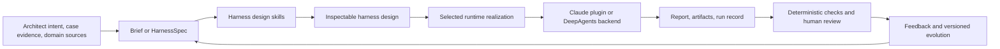

# HarnessWeaver: current design, examples, and open work

**Status reviewed:** 2026-10-20  
> **Superseded for the CAIN 2027 prototype (2026-10-24):** generation now runs through the unified `harness` skill in `src/harnessweaver/skills/`, with targets, sandboxes and baselines defined in [cain-2027/APPROACH.md](cain-2027/APPROACH.md) and current status in [cain-2027/STATUS.md](cain-2027/STATUS.md). The evidence recorded below remains valid as history.

**Purpose:** A practical reference for the current HarnessWeaver approach: what an architect supplies, what the examples produce, what belongs in a HarnessSpec, and what remains unverified.

## 1. What HarnessWeaver is

HarnessWeaver is a method and set of tools for designing task-specific agent harnesses. It starts from an architect's intent, domain sources, methodology, and runtime constraints. For a small one-off task, a short brief may be enough. For a reusable or complex harness, those decisions should be captured in a versioned `HarnessSpec`.

The HarnessSpec is a runtime-neutral design record. It describes the work, its sources, roles, activities, artifacts, checks, and human review points. The harness design skills use that design to prepare runtime artifacts. A runtime implementation then executes the harness and produces outputs. A spec is not itself an executable workflow, and the current validator checks its structure and references rather than automatically generating every runtime form.



The runtime-neutral contracts and spec validator live under `src/harnessweaver/`. DeepAgents-specific construction is isolated under `src/harnessweaver/adapters/deepagents/`. The current workflow/interaction combinations supported by the DeepAgents adapter are:

| Workflow strategy | Agent interaction | Current adapter behavior |
|---|---|---|
| `supervisor` | `one_shot_specialist_delegation` | A coordinator delegates a single result to named specialists. |
| `sequential_pipeline` | `typed_artifact_handoffs` | Declared stages run in order and pass validated typed artifacts. |
| `fan_out_fan_in` | `parallel_specialist_delegation` | Specialists run in parallel and a typed join waits for their results. |

Persistent peer-to-peer messaging and shared task-list collaboration are not mapped by this initial DeepAgents adapter. Runtime capability and fidelity limits should be recorded rather than assumed equivalent.

## 2. Inputs and outputs by example

| Example | What the architect supplies | What the current example prepares or generates | Maturity and limits |
|---|---|---|---|
| **ATAM evaluation** | An architecture description and available evidence; system scope; business goals and constraints; quality-attribute drivers/scenarios; relevant source material; desired report shape. The included banking case is usable as a sample. | The DeepAgents runner creates a structured ATAM report draft: utility tree, architectural approaches, scenario analysis, risks/non-risks, sensitivity/tradeoff points, semantic methodology state, and explicit gaps. It writes a session-specific JSON report and runtime sidecar. A Claude Code plugin with evaluator skills and specialist subagents is also prepared. | Most complete example. A supervisor run passed checks under the current semantic-state report contract. The five-stage sequential adapter passed checks before that contract refresh; later sequential attempts under the refreshed contract did not produce a report. Fan-out/fan-in is implemented, but a successful provider report under the current semantic-state contract remains outstanding. The prototype does not run stakeholder workshops or establish expert acceptance; an architect must review its draft. |
| **SAAM evaluation (WRCS)** | Architecture and scenario evidence. The included extraction represents 6 of 15 source scenarios; some metadata is inferred. Keep missing scenarios and inferred facts explicit. | A v0.2 spec and matched baseline/spec-guided pilot runs cover represented scenario classifications and change-impact analysis, with evidence links and limitations. | Separate, partial pilot, not the first ATAM demonstration. Both runs matched 5/6 classifications, and none of the five compared component/change-extent pairs matched. Two independent blind reviewer ratings are pending; those structural comparisons do not establish SAAM quality. |
| **Architecture design exploration (ADD-informed)** | A project-specific brief: system boundary, design goals, constraints, prioritized quality scenarios, existing architecture evidence, evaluation horizon, and non-goals. Keep reference solutions or expert-only notes out of generation input. | A v0.2 profile, source-to-method mapping, and review criteria describe design context, iteration goals, alternatives, architecture views, decisions/rationale, comparison, and architect review. | Profile and review protocol only. No project-specific brief, generated alternatives, paired comparison, or expert-reviewed result is present. ReArch is described as a separate research direction, not merged into this ADD profile. |

### ATAM data boundary

For the banking case, generation receives only `ATAM_Evaluation.evaluation_inputs` from `case-studies/architecture-eval/ATAM/data/banking.json`. `ground_truth_outputs` are reserved for evaluation and must not be passed to the generator or stored with generation runs. This keeps the prediction independent of the reference answers.

The report template is at `pilots/atam/sources/domain/references/atam-report-template.json`; ATAM domain activities and semantic progress are described in `pilots/atam/sources/methodology.yaml`. The implementation is intentionally a bounded ATAM analysis aid, not a claim that all ATAM phases or stakeholder activities were completed.

## 3. What to specify in a HarnessSpec

For a reusable harness, specify enough to make the intent, method, evidence boundary, expected artifacts, and review criteria clear. Do not fill unknowns with invented case facts. Reference source files and record their authority and limitations.

| Section | What belongs there | Version availability |
|---|---|---|
| `spec_version`, `id`, `domain` | Schema version, stable identifier, and domain. | v0.1 and v0.2 |
| `intent` | Goal, scope, and exclusions: what the harness should accomplish and what it must not claim or attempt. | v0.2 |
| `methodology` | Method name, source references, and explicit HarnessWeaver adaptations. Distinguish method-derived activities from runtime choices. | v0.2 |
| `semantic_state` | Domain progress assessments, evidence references, gaps, next-state requirements, and meaningful completion criteria. Runtime task completion is not proof of methodology progress. | v0.2 |
| `workflow` | Workflow identity and purpose; v0.2 can also state completion criteria. | Both; completion criteria in v0.2 |
| `orchestration` | Optional runtime preference with `workflow_strategy` and `agent_interaction` as separate dimensions. Only supported pairings are accepted by the current DeepAgents adapter. | v0.2 |
| `sources` | Referenced case data, methods, skills, schemas, or other material, with kind, authority, revision/notes as applicable. | Both |
| `roles` | Agent/responsibility identifiers, purposes, and optional skill references. | Both |
| `stages` | Activities with responsible role, purpose, inputs, and outputs. Add evidence-based prerequisites and completion criteria where useful. | Both; readiness and completion criteria in v0.2 |
| `artifacts` | Input, intermediate, and output artifacts, with descriptions and optional schema references. | Both |
| `verification` | Artifact criteria and how each check is performed: structural validation, provenance/evidence check, or human evaluation. | Both |
| `human_gates` | Review point, reason, and artifacts a person must inspect before consequential use. | Both |
| `runtime_requirements` | Required capabilities such as file access, structured output, or artifact persistence. | Both |

### Version choice

- **v0.1** captures a basic workflow: domain, workflow, sources, roles, stages, artifacts, verification, human gates, and runtime requirements. It has no dedicated intent, methodology, semantic-state, stage-readiness, or orchestration fields.
- **v0.2** adds intent, explicit methodology and adaptations, semantic progress and gaps, workflow/stage completion criteria, stage readiness, and optional orchestration preferences. It is the recommended starting point for new reusable harnesses.
- The loader and validator support both versions. The v0.2 `orchestration` section is optional in the schema; when present, the Python validator checks that its strategy/interaction pair is supported.
- A simple, bounded one-off can start from a lightweight brief without a saved spec when documenting the full design would add more work than value. Record that choice and its tradeoff.

### HarnessSpec versus methodology file

The HarnessSpec describes the harness as a whole: intent, source authority, roles, stages, artifacts, verification, runtime needs, human gates, and (in v0.2) semantic state and coordination preference. A separate methodology file can hold the more detailed domain procedure and its evidence/readiness rules. In the ATAM example, `methodology.yaml` expands the ATAM activities and state fields; the HarnessSpec references it and describes how it fits the harness. The two files should remain consistent, but they serve different levels of detail.

## 4. Current implementation and test evidence

### Local checks

- The full Python unit test suite passed: **75 tests** in the `harness` Conda environment (latest recorded run).
- HarnessSpec v0.1 and v0.2 loading/validation, supported orchestration profiles, and optional-backend-safe imports have test coverage.
- Fake-agent runtime tests cover supervisor delegation, pipeline order and typed handoffs, fan-out join completeness, and streaming/non-streaming report equivalence.
- ATAM tests cover structured report validation, generation/evaluation input separation, semantic-state reporting, failed/interrupt handling, and report publication behavior.
- SAAM pilot structural/evidence checks and design-exploration profile checks are covered.

### Provider and evaluation evidence

- **ATAM supervisor:** current semantic-state contract run completed with `openai:gpt-5.4-mini`; the deterministic ATAM source-scenario and semantic-state checks passed. The run is recorded in `benchmarks/atam/pilot-status.md`.
- **ATAM sequential pipeline:** the five declared stages completed and passed the deterministic source-scenario check before the report contract added required semantic-state output. Attempts under the refreshed contract were stopped or failed before a report. Do not treat the earlier run as evidence for the refreshed report contract or count stopped attempts as completed.
- **ATAM fan-out/fan-in:** implementation and fake-agent tests exist. Current semantic-state provider attempts did not produce a report; an earlier prompt revision did produce a structurally valid report, which is not evidence for the current contract.
- **SAAM:** matched baseline and spec-guided runs use the same case, model, input, and Pydantic report contract. Both pass structural/evidence-link checks; the partial reference comparison is 5/6 classifications and 0/5 matching component/change-extent pairs. Independent blind review is still pending.
- **Design exploration:** method mapping and review criteria are documented, but the case has not been run because a project-specific design brief and reviewers are outstanding.
- Provider trials are single-case/single-run evidence. They do not establish comparative quality, accuracy, completeness, reliable latency, or cost; cost data is unavailable. Human review is a separate gate from structural checks.

Run records and more detailed evidence are maintained in `benchmarks/atam/pilot-status.md` and `benchmarks/saam/pilot-report.md`.

## 5. Gaps and pending work

### Claude runtime and generation

- Run the prepared plugin's structural validation and smoke test in Claude Code using an input-only case. Instructions are in `pilots/atam/CLAUDE-TESTING.md`.
- Ask Claude to generate a second ATAM plugin from the v0.2 HarnessSpec in a scratch directory, then validate and compare it with the maintained plugin. Preserve the exact prompt, model/version, input hash, output, and manual edits.
- Recheck Claude's generated report and skills against the newer semantic-state contract. The maintained Claude plugin's live execution has not been repeated against that contract.
- Compare Claude and DeepAgents fidelity, artifact structure, evidence treatment, gaps, and human review behavior under matched inputs. Do not claim runtime equivalence from matching file layouts.

### Example progression and review

- **ATAM:** obtain blind review from qualified architects for current outputs; complete a current-contract fan-out provider run if bounded verification is resumed. The previous long-running attempts were stopped; do not treat them as passing runs.
- **SAAM:** obtain two independent locked reviewer forms for the current anonymized pair. Keep the arm key and evaluator-only references withheld until ratings are locked. Then document disagreements and the scope limits caused by the partial six-scenario extraction.
- **Design exploration:** obtain the promised project brief and identify two qualified reviewers; instantiate the ADD profile, generate alternatives, and run the predeclared review protocol. Do not use the paper's example output as ground truth for the new case.
- **Evolution:** demonstrate evidence-linked changes to a harness from execution/reviewer feedback, preserving baseline artifacts and using the same case-specific checks for before/after comparison.
- **U4 / general HarnessWeaver:** continue validating the canonical harness/evolve skills against scenario fixtures; ensure guidance, HarnessSpec, and generated Harness IR remain aligned and provenance/fidelity limits are carried into runtime artifacts. Broad automatic generation and a general-purpose workflow engine remain deferred.
- **Runtime coverage:** current DeepAgents coverage is limited to the three declared profiles and supported pairings. Other agent-interaction semantics (especially persistent collaboration) need explicit capability mapping before they can be represented as supported.
- **Measurement:** define repeatable measures for generation time, functional completeness, result accuracy/usefulness, and cost before making comparative claims. Current single runs and missing cost values are insufficient.

The implementation roadmap remains the product-level source of direction. The U4–U7 execution plan records technical scope and verification expectations. These documents and the pilot reports should be updated together as evidence changes.

## 6. Useful entry points

- `src/harnessweaver/skills/harness/SKILL.md` — shared harness-design approach.
- `src/harnessweaver/skills/evolve/SKILL.md` — feedback and evolution approach.
- `specs/harnessspec/v0.1.schema.json` and `specs/harnessspec/v0.2.schema.json` — machine-readable spec contracts.
- `pilots/atam/harnessspec-v0.2.yaml` — most complete current HarnessSpec example.
- `pilots/atam/sources/methodology.yaml` and `pilots/atam/sources/domain/references/atam-report-template.json` — ATAM method profile and output contract.
- `pilots/atam/deepagents/README.md` — run/configuration guide for the DeepAgents implementation.
- `pilots/atam/CLAUDE-TESTING.md` — deferred Claude plugin and generation experiments.
- `pilots/saam/harnessspec.yaml` and `benchmarks/saam/pilot-report.md` — partial SAAM profile and evidence.
- `pilots/design-exploration/harnessspec.yaml`, `method-mapping.md`, and `review-criteria.md` — ADD-informed profile and pending review setup.
- `benchmarks/atam/pilot-status.md` — ATAM provider runs, checks, failures, and fidelity limitations.

To validate a spec from the repository root:

```bash
conda run -n harness hw validate pilots/atam/harnessspec-v0.2.yaml
```
