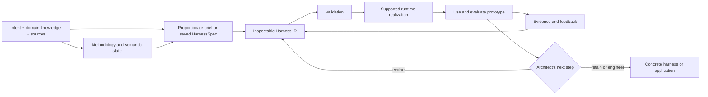

# HarnessWeaver Implementation Roadmap - Plan

## Goal Capsule

- **Objective:** Establish HarnessWeaver as a practical way to turn explicit task intent, domain knowledge, and methodology into an inspectable agent harness prototype that can be evaluated and evolved before committing to a specific agent architecture or runtime.
- **Means:** Keep the representation proportionate, make methodology state explicit, then ground it in separate architecture-evaluation and architecture-design-exploration case studies before expanding runtime support.
- **Authority:** This plan is the implementation guide. Preserve existing case-study projects and their provenance while establishing ownership and boundaries.
- **Stop condition:** The first milestone is complete when one explicit methodology and its semantic state can be represented, validated, and used to produce an editable architecture-evaluation prototype; a second design-exploration case tests whether the representation covers a materially different architecture task. Both studies report evidence limits.

## Product Contract

### Summary

HarnessWeaver separates task intent, domain knowledge, and methodology from the agent arrangement and runtime that enact them. A proportionate HarnessSpec may capture these assets in a saved artifact; a lightweight one-off may proceed without one when the formal artifact adds more overhead than value. The generator produces an inspectable Harness IR, including domain-semantic methodology state, then supported adapters materialize it as a skills-based harness or Python/DeepAgents application. Evaluation and feedback guide revision of that prototype. HarnessWeaver does not currently search for, rank, or guarantee an optimal harness.

### Problem Frame

Domain-specific agent systems are commonly built as custom framework applications or by manually specializing a general-purpose harness. In both cases methodology can become distributed across prompts, tools, orchestration, and runtime state. HarnessWeaver tests whether making intent, domain knowledge, methodology, and semantic progress explicit can lower the cost of producing and changing a useful prototype. The repository supplies architecture-evaluation and architecture-design-exploration case material; these cases should ground the representation rather than be treated as interchangeable benchmarks.

### Requirements

#### Project structure and boundaries

- R1. Establish clear ownership and source-of-truth rules for shared methodology, HarnessSpec, Python code, runtime-specific skills, domain packages, and standalone case studies.
- R2. Preserve case-study history, attribution, licenses, and research artifacts. Do not move, rewrite, or merge standalone projects until their ownership and provenance are recorded.
- R3. Keep HarnessSpec and domain rules independent of any one runtime. Runtime adapters must report unsupported or lossy mappings.
- R3a. Represent task intent, domain knowledge, methodology, and methodology state as separable concerns. Methodology state describes semantic progress and evidence; keep it distinct from agent working state and runtime execution state.

#### Python core and agent skills

- R4. Provide a Python package that loads and validates versioned HarnessSpec documents and reports actionable validation errors.
- R5. Make the harness-design and evolution skills read, create, validate, and update HarnessSpec while preserving user-provided domain materials and provenance.
- R5a. Allow proportionate inputs: use an inline design brief or direct harness generation for a simple one-off; use a saved, versioned HarnessSpec when reuse, validation, or evolution justifies it.
- R6. Keep shared agent instructions portable. Put Claude-specific paths and runtime behavior in a Claude adapter or runtime-specific guidance.

#### Evaluation and evolution

- R7. Ground the design in distinct architecture-evaluation and architecture-design-exploration case studies, comparing a baseline and a HarnessWeaver-guided prototype where defensible reference evidence exists.
- R8. Evaluate structural correctness, domain task quality, expert judgment, and operational cost separately. Do not use lexical similarity or an LLM judge as the only success measure.
- R9. Record the input sources, any saved spec and IR versions, harness version, runtime/model configuration, evaluation results, and material feedback for each pilot run.

### Scope Boundaries

#### Included

- A versioned, minimal HarnessSpec contract and example.
- Python loading, validation, and an initial command-line validation path.
- Spec-aware harness and evolution skills, with portable guidance and runtime-specific boundaries.
- An architecture-evaluation pilot using the SAAM revision-control case where its partial extracted reference data supports a bounded comparison.
- An architecture-design-exploration case grounded in Attribute-Driven Design and ReArch, with evaluation criteria defined before any quality claim.
- A later skills/DeepAgents materialization study that records capability gaps and semantic loss.

#### Deferred for later

- General-purpose workflow execution engine.
- Broad automatic code generation for every runtime.
- Full migration or consolidation of standalone case-study repositories.
- Multi-domain benchmark coverage beyond the first architecture-focused pilots.
- Advanced autonomous evolution, optimization, or model-selection loops.
- Autonomous search, ranking, or selection of an optimal harness architecture.

#### Outside this plan

- Rebuilding the software-architecture-agent product or its frontend.
- Changing ATAM/SAAM research data or ground-truth records.
- Publishing releases or moving repositories between owners.

## Planning Contract

### Key Technical Decisions

- KTD1. Start architecture evaluation with the SAAM revision-control case in `case-studies/architecture-eval/SAAM/data/revision_control_system.json`. Its extracted ground truth is partial: six of fifteen scenarios are represented and some details are inferred. Use it for a bounded pilot, expose those limits, and do not score missing outputs as known answers.
- KTD2. Use HarnessSpec as a proportionate container for logically distinct intent, domain, and methodology assets. Keep methodology activities, artifacts, readiness, validation, completion, and semantic state explicit; formalize only the fields needed for reliable validation and consumers.
- KTD3. Keep the first Python deliverable to spec loading, validation, and clear diagnostics. Do not build a general workflow engine before the contract has been exercised.
- KTD4. Treat evaluation as multiple evidence sources: deterministic schema/artifact checks, domain-specific criteria, blind expert review where applicable, and cost or latency. Existing text-similarity and LLM-judge metrics are supporting signals only.
- KTD5. Use Attribute-Driven Design and ReArch as separate conceptual foundations for the architecture-design-exploration case. Do not treat either paper as complete ground truth; define scenario inputs, expert review criteria, and expected artifacts before measuring quality.
- KTD6. Use the software-architecture-agent as a later realization study, not the definition of HarnessWeaver. Its Firebase/API/frontend coupling and Stage 1 `user_id`/`project_id` mismatch must be resolved within an established ownership boundary before execution claims.
- KTD7. Keep HarnessWeaver's current claim at rapid generation and feedback-driven evolution of a viable prototype. Do not claim optimal-design search, automatic ranking, universal speed gains, or full runtime portability.

### High-Level Technical Design

HarnessWeaver has four cooperating parts:

1. **Intent and domain assets:** goals, constraints, domain concepts, source material, and provenance. They may be stored in a HarnessSpec or supplied directly for a one-off.
2. **Methodology and state:** activities, techniques, readiness/dependencies, artifacts, validation, completion, and domain-semantic progress with evidence and open gaps. This state is distinct from agent and runtime bookkeeping.
3. **Harness IR and Python core:** an inspectable representation of how intent, domain assets, and methodology are enacted. Python parses and validates saved specs and IR, with clear diagnostics; framework-specific execution stays out of the core.
4. **Generator/evolver and runtime adapters:** agent skills create or revise the IR, then supported adapters materialize it and report unsupported or lossy mappings. The architect evaluates the prototype and decides whether to evolve it, retain it as a harness, or engineer a dedicated application.

The initial flow is:

The IR is a working representation for generation and evolution, not a search space for autonomous optimization.

## Implementation Units

### U1. Establish repository inventory and ownership boundaries

- **Goal:** Make the current repository and the three standalone case studies understandable before restructuring them.
- **Files:** `README.md`, `README_EN.md`, `docs/consolidation-plan.md`, `case-studies/` and relevant nested repository metadata.
- **Approach:** Record tracked, untracked, ignored, and nested-repository content; identify canonical copies of skills and docs; record each case study's owner, license, runtime, purpose, and intended relationship to HarnessWeaver. Resolve existing contradictions in the root documentation without moving case-study files.
- **Test scenarios:** The inventory accounts for all three case studies and distinguishes app code, skills, research inputs, ground truth, generated outputs, and duplicated package copies. A contributor can identify where a shared-methodology, Python, runtime, or domain change belongs.
- **Verification:** Review the inventory against the repository tree and Git metadata. Confirm no case-study source or research artifact was changed.
- **Depends on:** None.

### U2. Establish HarnessSpec v0.1 and a methodology example

- **Goal:** Establish the initial shared contract used by Python and harness-design skills.
- **Files:** `specs/harnessspec/v0.1.schema.json` and `examples/atam/harnessspec.yaml`.
- **Approach:** Maintain the current versioned contract for sources, roles, stages, artifact contracts, verification, human gates, and runtime requirements. The later methodology/state work in U4 determines whether an additive versioned extension is needed for intent, domain knowledge, methodology, and Harness IR. Keep agent working state and runtime execution state separate. Use a compact saved spec for reusable/complex workflows and permit direct lightweight input for one-offs. Do not copy reference answers into generation inputs.
- **Test scenarios:** A valid example expresses the current workflow and its artifacts. Missing required fields, unknown spec versions, invalid references, and unsupported runtime capabilities produce clear, actionable diagnostics in the consumer contract.
- **Verification:** Validate the existing example against the v0.1 schema. Compare its coverage with the SAAM/ATAM and design-exploration workflows; record missing concepts for U4 without turning paper-specific procedures into universal architecture rules.
- **Depends on:** U1.

### U3. Create the Python package and validation command

- **Goal:** Give HarnessWeaver a usable Python foundation without introducing a workflow engine.
- **Files:** Add standard Python project metadata, package source, command-line entry point, and focused unit tests under the new HarnessWeaver package area.
- **Approach:** Implement spec loading, version checks, structural validation, reference checks, and actionable error reporting. Keep models and validation independent of DeepAgents, Firebase, and provider clients.
- **Test scenarios:** Valid YAML/JSON loads to the same normalized model; malformed documents and unsupported versions fail with useful locations and messages; missing referenced skill or artifact files are identified; validation does not modify the input spec.
- **Verification:** Run the package's unit tests and validate the U2 example from the command line. Confirm importing the core does not require a model API key or initialize an agent runtime.
- **Depends on:** U2.

### U4. Make methodology and semantic state first-class in harness/evolve skills

- **Goal:** Enable the generator and evolver to turn task intent, domain assets, and methodology into an inspectable Harness IR while keeping methodology state independent of agent/runtime state.
- **Files:** Canonical harness and evolve skills, portable references, and runtime-specific Claude guidance where needed.
- **Approach:** Inspect supplied material and identify what is intent, domain knowledge, methodology, or runtime constraint. For reusable/complex work, create or update and validate a proportionate HarnessSpec; for a simple one-off, proceed with a compact brief and do not force a saved spec. Generate an IR that names activities, readiness, artifacts, validation, completion, semantic state, evidence, and gaps. Assess the existing v0.1 schema against these needs; if it cannot express them, define a versioned extension and retain compatibility with v0.1 inputs. Keep verifier, checker, and evaluator as distinct responsibilities without requiring separate agents. Evolution maps feedback to the right layer, preserves provenance and baselines, and updates methodology state only from evidence. Keep portable instructions separate from runtime-specific output conventions.
- **Test scenarios:** A simple prompt can produce a useful one-off without a saved spec; a reusable architecture workflow gets an explicit methodology and semantic-state model; existing skills/sources retain provenance; conflicts and missing readiness evidence are surfaced; runtime state is not mistaken for methodology progress; feedback updates the appropriate layer.
- **Verification:** Run skill-trigger and near-miss scenarios, inspect generated artifacts against the v0.1 example and any versioned extension, and check that the skills do not claim runtime support that the adapter has not implemented.
- **Depends on:** U2 and U3.

### U5. Pilot the architecture-evaluation methodology on the SAAM revision-control case

- **Goal:** Test whether the methodology/state representation can guide a useful, evidence-grounded architecture-evaluation prototype on a bounded reference case.
- **Files:** Add a HarnessWeaver-owned benchmark configuration, run records, and evaluation report without modifying upstream data or ground truth.
- **Approach:** Use the source-grounded WRCS revision-control case and make the evaluation input/reference boundary explicit. The JSON marks its extraction partial: six of fifteen scenarios are represented and some details are inferred. Restrict reference scoring to represented fields and scenarios; track the missing material as unknown. Compare a baseline with a HarnessWeaver-guided harness under matched settings. Keep expected results and evaluation-only material out of generation inputs. Treat human review, evidence links, requirement/scenario coverage, risks, tradeoffs, and missing information separately.
- **Test scenarios:** Each run yields contract-valid output; deterministic checks cover represented SAAM scenario references and evidence links; reviewers assess method completeness and evidence-grounded reasoning; evaluation results can be traced to exact inputs, spec/IR, harness, and runtime configuration.
- **Verification:** Complete paired baseline and guided runs. Report structure, scenario coverage, evidence support, expert review, omissions, and cost/latency separately. State that partial reference data limits accuracy claims; do not infer completeness or generalize from one case. Treat similarity and LLM-judge scores as supporting signals only.
- **Depends on:** U2, U3, and U4.

### U6. Model architecture design exploration as a distinct methodology case

- **Goal:** Determine whether the same conceptual Harness IR can express architecture design exploration without collapsing it into an evaluation workflow.
- **Files:** HarnessWeaver-owned ADD/ReArch methodology profile, scenario inputs, artifacts, and evaluation protocol; use the sources listed in `docs/research-foundations.md`.
- **Approach:** Define the design task, quality drivers, alternatives, decision rationale, architecture views, iteration/review points, and evidence expected from the selected method. Separate method-derived rules from HarnessWeaver adaptation choices. Define task-specific expert review and baseline before generation; do not treat paper examples as ground truth for new scenarios.
- **Test scenarios:** A design-exploration case expresses its own inputs, progression, decisions, alternatives, and outputs; evaluators distinguish evidence-grounded tradeoffs from unsupported or duplicated recommendations; human review of critical decisions is represented.
- **Verification:** Produce a method-to-IR mapping and at least one reviewed prototype comparison under a declared protocol. Record ambiguity and human intervention. Do not claim this demonstrates one universal architecture-design method.
- **Depends on:** U2 and U4; U5 informs the evaluation protocol.

### U7. Materialize and evolve the prototypes across supported realization paths

- **Goal:** Test realization fidelity and feedback-driven evolution for the evaluation and exploration prototypes, then document when a lightweight harness remains appropriate or needs a dedicated application.
- **Files:** HarnessWeaver-owned skills and Python/DeepAgents adapter mappings; portability and evolution run records; use `case-studies/software-architecture-agent/` only as an application reference after ownership and its Stage 1 contract are resolved.
- **Approach:** Materialize the same methodology/IR in supported forms. Record unsupported capabilities, semantic loss, manual steps, and runtime state handling. Apply one bounded, evidence-linked change to each selected prototype, preserve baselines, and reevaluate under the same criteria. Keep application services (Firebase, auth, API, UI) outside the generic representation. Treat portability as measured fidelity, not assumed equivalence.
- **Test scenarios:** Runtime forms preserve declared methodology intent and semantic state or report loss; feedback maps to a domain/methodology/IR/adapter change; prior versions remain inspectable; evolved versions are compared to baselines on the same criteria.
- **Verification:** Report artifact quality, fidelity gaps, change effort, operational cost where available, and regressions. The comparison remains scoped to tested methods and runtimes.
- **Depends on:** U4-U6.

## Verification Contract

| Gate | Applies to | Evidence required |
|---|---|---|
| Contract validation | U2, U3 | Saved specs and IR preserve intent/domain/methodology boundaries; semantic state is distinct from runtime bookkeeping; invalid versions, references, and required fields produce actionable errors. |
| Skill conformance | U4 | Trigger and near-miss scenarios pass; generated artifacts map to declared spec fields and preserve provenance. |
| Evaluation-method validity | U5, U6 | Baseline/prototype runs use declared criteria; source evidence, expert review, missing references, and unknowns are recorded; no ground-truth leakage. |
| Runtime boundary | U7 | Runtime-specific behavior is isolated; unsupported features and semantic loss are explicit. |
| Evolution quality | U7 | Baseline and evolved harnesses are versioned and compared under the same method-specific protocol. |

Do not run model-based benchmark cases without recording model/runtime versions and settings. Separate evaluation-only credentials and output locations from generation inputs. Do not modify source case-study data or ground truth as part of a run.

## Definition of Done

- The repository has documented ownership and boundaries for intent/domain assets, methodology and state, Harness IR, Python validation, runtime adapters, and case studies.
- HarnessSpec v0.1 and a proportionate lightweight path can represent an architecture-evaluation methodology and its semantic state.
- A Python package can validate the example without initializing a model runtime.
- The harness and evolve skills use the spec and preserve provenance across generated and revised artifacts.
- An architecture-evaluation pilot reports evidence and limitations from the partial SAAM revision-control reference data.
- A distinct architecture-design-exploration case demonstrates and reviews an ADD/ReArch-informed methodology mapping.
- Runtime realization and evolution results identify which intent/state is preserved, what loses fidelity, and which changes improve the measured criteria.
- No standalone case-study project is merged, moved, or altered without its ownership and provenance being established.
