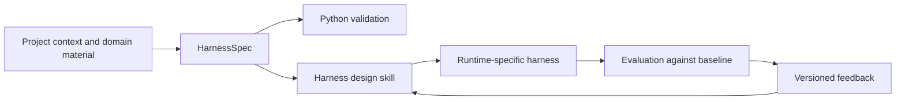

# HarnessWeaver Implementation Roadmap - Plan

## Goal Capsule

- **Objective:** Establish HarnessWeaver as a maintainable project with a Python core and agent-executed skills that use a shared HarnessSpec, then validate that approach against real case studies.
- **Means:** Define the smallest useful spec and build in dependency order, beginning with the ArchEval ATAM workflow as the benchmark.
- **Authority:** This plan is the implementation guide. Preserve existing case-study projects and their provenance while establishing ownership and boundaries.
- **Stop condition:** The first milestone is complete when a versioned spec can describe one ATAM workflow, Python can validate it, the harness skill can use it to produce a harness design, and a repeatable pilot compares that result with a baseline.

## Product Contract

### Summary

HarnessWeaver will combine a Python project and a set of skills that can be run in Claude Code and other coding agents. The shared spec will describe harness intent and runtime-neutral design. Python components and coding-agent skills will use that spec to validate, generate, materialize, evaluate, and evolve harnesses over time.

### Problem Frame

The repository contains useful harness-design skills, a DeepAgents application, and architecture-evaluation research projects, but no shared machine-readable contract or Python package that ties them together. The existing skills primarily describe Claude Code artifacts, and the DeepAgents material describes a porting workflow rather than an adapter that consumes a common spec.

### Requirements

#### Project structure and boundaries

- R1. Establish clear ownership and source-of-truth rules for shared methodology, HarnessSpec, Python code, runtime-specific skills, domain packages, and standalone case studies.
- R2. Preserve case-study history, attribution, licenses, and research artifacts. Do not move, rewrite, or merge standalone projects until their ownership and provenance are recorded.
- R3. Keep HarnessSpec and domain rules independent of any one runtime. Runtime adapters must report unsupported or lossy mappings.

#### Python core and agent skills

- R4. Provide a Python package that loads and validates versioned HarnessSpec documents and reports actionable validation errors.
- R5. Make the harness-design and evolution skills read, create, validate, and update HarnessSpec while preserving user-provided domain materials and provenance.
- R6. Keep shared agent instructions portable. Put Claude-specific paths and runtime behavior in a Claude adapter or runtime-specific guidance.

#### Evaluation and evolution

- R7. Use a case study with repeatable inputs and reference outputs to compare a baseline harness with a spec-guided harness.
- R8. Evaluate structural correctness, domain task quality, expert judgment, and operational cost separately. Do not use lexical similarity or an LLM judge as the only success measure.
- R9. Record the spec version, harness version, runtime and model configuration, task inputs, evaluation results, and material feedback for each pilot run.

### Scope Boundaries

#### Included

- A versioned, minimal HarnessSpec contract and example.
- Python loading, validation, and an initial command-line validation path.
- Spec-aware harness and evolution skills, with portable guidance and runtime-specific boundaries.
- An ArchEval ATAM pilot, followed by a DeepAgents integration study using the software-architecture-agent case study.

#### Deferred for later

- General-purpose workflow execution engine.
- Broad automatic code generation for every runtime.
- Full migration or consolidation of standalone case-study repositories.
- Multi-domain benchmark coverage beyond the first architecture-focused pilots.
- Advanced autonomous evolution, optimization, or model-selection loops.

#### Outside this plan

- Rebuilding the software-architecture-agent product or its frontend.
- Changing ATAM/SAAM research data or ground-truth records.
- Publishing releases or moving repositories between owners.

## Planning Contract

### Key Technical Decisions

- KTD1. Start the first benchmark with the ATAM slice of ArchEval. It has structured inputs and reference outputs, an executable agent workflow, and existing evaluation assets. Begin with a small subset to control runtime and review cost.
- KTD2. Begin HarnessSpec as a documented contract plus one example, then formalize its machine-readable schema when Python and skill consumers need a stable validation boundary.
- KTD3. Keep the first Python deliverable to spec loading, validation, and clear diagnostics. Do not build a general workflow engine before the contract has been exercised.
- KTD4. Treat evaluation as multiple evidence sources: deterministic schema/artifact checks, domain-specific criteria, blind expert review where applicable, and cost or latency. Existing text-similarity and LLM-judge metrics are supporting signals only.
- KTD5. Use the software-architecture-agent case study after the ArchEval pilot to test DeepAgents materialization and application integration. Its current Firebase/API/frontend coupling makes it a poor first benchmark, and its Stage 1 call contract must be reconciled before it is treated as a working reference.

### High-Level Technical Design

HarnessWeaver has three cooperating parts:

1. **Shared contract and domain model:** versioned HarnessSpec plus domain-specific references and provenance. This layer defines intent, workflow, roles, skill references, artifacts, verification, human gates, and runtime capabilities without runtime syntax.
2. **Python package:** parses and validates HarnessSpec, exposes stable diagnostics, and later provides adapter and evaluation interfaces. Application persistence and framework-specific execution remain outside the core package.
3. **Agent skills and runtime adapters:** skills inspect project context and produce or evolve spec-guided harnesses. A portable skill layer carries common design instructions; Claude Code and Python/DeepAgents adapters translate the shared design into runtime artifacts and report fidelity limits.

The initial flow is:

## Implementation Units

### U1. Establish repository inventory and ownership boundaries

- **Goal:** Make the current repository and the three standalone case studies understandable before restructuring them.
- **Files:** `README.md`, `README_EN.md`, `docs/consolidation-plan.md`, `case-studies/` and relevant nested repository metadata.
- **Approach:** Record tracked, untracked, ignored, and nested-repository content; identify canonical copies of skills and docs; record each case study's owner, license, runtime, purpose, and intended relationship to HarnessWeaver. Resolve existing contradictions in the root documentation without moving case-study files.
- **Test scenarios:** The inventory accounts for all three case studies and distinguishes app code, skills, research inputs, ground truth, generated outputs, and duplicated package copies. A contributor can identify where a shared-methodology, Python, runtime, or domain change belongs.
- **Verification:** Review the inventory against the repository tree and Git metadata. Confirm no case-study source or research artifact was changed.
- **Depends on:** None.

### U2. Define HarnessSpec v0.1 and an ATAM example

- **Goal:** Establish the smallest shared contract needed by Python and the harness-design skills.
- **Files:** Add the canonical HarnessSpec documentation/schema location and an example under the repository's chosen shared-spec and example directories.
- **Approach:** Define spec versioning, domain/workflow identifiers, stages, roles, skill references, source provenance, input/output artifact contracts, verification criteria, human gates, and runtime capability requirements. Use references for long domain instructions instead of copying them into the spec. Model one ArchEval ATAM workflow without copying reference answers into generation inputs.
- **Test scenarios:** A valid example expresses the current workflow and its artifacts. Missing required fields, unknown spec versions, invalid references, and unsupported runtime capabilities produce clear, actionable diagnostics in the consumer contract.
- **Verification:** Review the example against the ArchEval ATAM workflow, the existing harness skill, and the DeepAgents port mapping. Record fields that cannot be represented without embedding runtime or domain-specific assumptions.
- **Depends on:** U1.

### U3. Create the Python package and validation command

- **Goal:** Give HarnessWeaver a usable Python foundation without introducing a workflow engine.
- **Files:** Add standard Python project metadata, package source, command-line entry point, and focused unit tests under the new HarnessWeaver package area.
- **Approach:** Implement spec loading, version checks, structural validation, reference checks, and actionable error reporting. Keep models and validation independent of DeepAgents, Firebase, and provider clients.
- **Test scenarios:** Valid YAML/JSON loads to the same normalized model; malformed documents and unsupported versions fail with useful locations and messages; missing referenced skill or artifact files are identified; validation does not modify the input spec.
- **Verification:** Run the package's unit tests and validate the U2 example from the command line. Confirm importing the core does not require a model API key or initialize an agent runtime.
- **Depends on:** U2.

### U4. Make the harness and evolve skills spec-aware

- **Goal:** Enable coding-agent skills to use HarnessSpec as the shared design contract.
- **Files:** Canonical harness and evolve skills, portable references, and runtime-specific Claude guidance where needed.
- **Approach:** Extend the harness workflow to inspect supplied project materials, create or update a compact spec, validate it, and materialize the smallest fitting runtime harness. Extend evolution to connect feedback to a spec, domain guidance, or adapter change and preserve the baseline/version trail. Keep portable behavior separate from Claude-specific output conventions.
- **Test scenarios:** A short prompt produces a proportionate spec; an existing skill bundle is reused with provenance; conflicting sources are surfaced; unsupported runtime needs are reported; feedback updates the correct layer without silently changing domain requirements.
- **Verification:** Run skill-trigger and near-miss scenarios, inspect generated artifacts against the U2 example, and check that the skills do not claim runtime support that the adapter has not implemented.
- **Depends on:** U2 and U3.

### U5. Run the ArchEval ATAM benchmark pilot

- **Goal:** Measure whether a HarnessSpec-guided harness improves task results over a baseline.
- **Files:** Add a HarnessWeaver-owned benchmark configuration, run records, and evaluation report without modifying upstream data or ground truth.
- **Approach:** Select a small, representative ATAM subset. Keep `evaluation_inputs` separate from `ground_truth_outputs`; give the generator and evaluated harness only the intended inputs. Compare baseline and spec-guided harnesses under matched runtime/model settings and record costs and latency when available.
- **Test scenarios:** Each run yields schema-valid output; deterministic checks cover required ATAM sections and referential integrity; blind reviewers assess architecture-method completeness and evidence-grounded reasoning; evaluation results can be traced to exact inputs, spec, harness, and runtime configuration.
- **Verification:** Complete at least one baseline and one spec-guided run on the same case. Report structural pass rate, domain review results, material failure modes, and operational cost. Treat existing lexical metrics and LLM-judge scores as supplementary evidence.
- **Depends on:** U2, U3, and U4.

### U6. Validate the Python/DeepAgents adapter against the software-architecture-agent case study

- **Goal:** Test whether the shared spec can guide a real Python agent application while keeping domain logic separate from application wiring.
- **Files:** Adapter boundary and selected integration points in `case-studies/software-architecture-agent/backend/app/agents/` and `app/services/`, subject to the ownership decision from U1.
- **Approach:** Map the four existing stages, their skill folders, and artifact contracts to HarnessSpec. Keep Firebase, authentication, API, and UI concerns in the application. Resolve the existing Stage 1 `user_id`/`project_id` argument mismatch before using this application as an execution reference.
- **Test scenarios:** Each stage receives the correct inputs and produces its declared artifacts; missing prior-stage artifacts fail clearly; application persistence remains behind the application boundary; unsupported spec features are reported rather than silently dropped.
- **Verification:** Run focused adapter and stage-contract tests, then one end-to-end scenario with external services stubbed or configured explicitly. Confirm the same domain-stage intent remains visible in the spec and runtime output.
- **Depends on:** U1 through U5.

### U7. Add portability and evolution scenarios

- **Goal:** Broaden the benchmark beyond the first runtime and test whether feedback leads to controlled improvements.
- **Files:** Portable-skill scenario fixtures and evaluation records; use `case-studies/atam-evaluator/archevaluation-llms/` as a prompt-based portability case.
- **Approach:** Test a coding-agent skill workflow that relies on staged prompts and document inputs. Add one contrasting case only after defining its success criteria. Run evolution from recorded feedback and compare the revised harness with its saved baseline.
- **Test scenarios:** A non-Claude agent can follow the portable instructions or reports the unsupported capability; staged document inputs remain traceable; an evolution change is attributable to feedback and does not erase prior versions; the revised harness is evaluated under the same protocol as its baseline.
- **Verification:** Publish a comparison covering spec validity, output quality, portability gaps, cost/latency where available, and whether evolution improved the measured criteria without introducing regressions.
- **Depends on:** U4 and U5; U6 informs adapter coverage.

## Verification Contract

| Gate | Applies to | Evidence required |
|---|---|---|
| Contract validation | U2, U3 | Valid example accepted; invalid versions, references, and required fields produce actionable errors. |
| Skill conformance | U4 | Trigger and near-miss scenarios pass; generated artifacts map to declared spec fields and preserve provenance. |
| Benchmark validity | U5 | Matched baseline/spec-guided runs; no ground-truth leakage; deterministic checks and independent domain review recorded. |
| Runtime boundary | U6, U7 | Runtime-specific behavior is isolated; unsupported features and semantic loss are explicit. |
| Evolution quality | U7 | Baseline and evolved harness are versioned and compared under the same evaluation protocol. |

Do not run model-based benchmark cases without recording model/runtime versions and settings. Separate evaluation-only credentials and output locations from generation inputs. Do not modify source case-study data or ground truth as part of a run.

## Definition of Done

- The repository has documented ownership and layer boundaries for shared methodology, HarnessSpec, Python code, runtime adapters, and the three case studies.
- HarnessSpec v0.1 has a versioned contract and an ArchEval ATAM example.
- A Python package can validate the example without initializing a model runtime.
- The harness and evolve skills use the spec and preserve provenance across generated and revised artifacts.
- A small ArchEval pilot compares baseline and spec-guided harnesses with separate structural, domain-quality, and operational evidence.
- The software-architecture-agent integration path documents and tests the mapping between spec, stages, skills, artifacts, and runtime limitations.
- Portability and evolution results identify what works, what loses fidelity, and which criteria should guide the next iteration.
- No standalone case-study project is merged, moved, or altered without its ownership and provenance being established.
