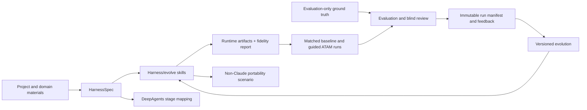

# HarnessWeaver U4-U7 Implementation Plan - Plan

## Goal Capsule

- **Objective:** Complete roadmap units U4-U7 by making the skills HarnessSpec-aware, measuring one ArchEval ATAM pilot, integrating the contract with the software-architecture-agent case study, and evaluating portability and controlled evolution.
- **Means:** Finish U4 and U5 first; proceed to U6 and U7 only after the benchmark protocol and initial pilot produce usable evidence.
- **Authority:** `STRATEGY.md` sets product direction; `CONCEPTS.md` defines shared terminology; `docs/harnessweaver-implementation-roadmap.md` remains the source of implementation scope and sequence. This plan supplies execution detail for U4-U7 without editing that roadmap.
- **Stop condition:** Each unit has traceable artifacts and verification evidence; the benchmark records limits and failures as well as successes; standalone case studies remain intact unless ownership and provenance authorize a change.

## Product Contract

### Summary

HarnessWeaver joins a versioned, runtime-neutral HarnessSpec, a Python core, and agent skills/adapters. This plan covers the work after the initial inventory, spec, and Python validator (U1-U3): skill adoption, an initial matched benchmark, a DeepAgents application study, and portability/evolution scenarios.

### Requirements

- R1. Harness and evolve skills use HarnessSpec for reusable or complex harnesses, with provenance and domain materials preserved; allow a simple one-off to proceed without a saved spec when the spec overhead outweighs its value.
- R2. Shared skill guidance stays portable; runtime-specific paths and behavior are isolated and unsupported or lossy mappings are reported.
- R3. The ATAM pilot compares baseline and spec-guided harnesses on matched inputs and runtime/model settings, without exposing evaluation ground truth to generation.
- R4. Evaluation reports deterministic structure, domain quality, expert judgment, and operational cost separately. Similarity and LLM-judge scores remain supporting signals.
- R5. Every run records input, spec, harness, runtime/model configuration, results, and feedback sufficiently to reproduce or explain it.
- R6. The software-architecture-agent study maps spec intent to its stages and artifacts while keeping application wiring outside the shared contract.
- R7. Portability and evolution scenarios retain baselines, disclose fidelity gaps, and compare revisions under the same evaluation protocol.
- R8. Keep the first proof in software architecture evaluation and design exploration; preserve the roadmap’s scope boundaries, case-study provenance, and existing research/ground-truth data.

### Scope Boundaries

Included: canonical skill-source and synchronization rules; spec-aware harness/evolve behavior; a bounded ATAM pilot; one DeepAgents mapping/integration study; one non-Claude portability scenario; one feedback-driven evolution comparison.

Deferred: general workflow execution, broad automatic generation, multi-domain benchmark claims, full case-study consolidation, autonomous optimization, and provider/model selection loops. Do not rebuild the software-architecture-agent UI or change evaluation ground truth.

## Planning Contract

### Key Technical Decisions

- KTD1. Keep the existing roadmap unchanged and use this dated plan as a separate execution artifact for U4-U7, grounded by `STRATEGY.md` and `CONCEPTS.md`.
- KTD2. Use the ArchEval ATAM banking case for the first bounded pilot. A one-case pilot demonstrates the protocol only; it does not support a general quality claim.
- KTD3. Run baseline and spec-guided variants through the same ArchEval execution/evaluation substrate, changing only the harness guidance and recording unavoidable differences.
- KTD4. Keep generator inputs and evaluation-only ground truth in separate paths and permissions. Blind reviewers see anonymized arm labels until their scores are locked.
- KTD5. Keep adapter fidelity/loss reporting outside HarnessSpec v0.1 unless the existing schema already provides a suitable field; avoid expanding the contract just for one pilot.
- KTD6. Treat `harness-en/skills/` as the current active harness/evolve skill tree. The root README and `harness-en/README.md` still describe removed `skills/` and `packages/harness-en/` locations; correct those ownership and install references as part of U4. Recheck for other copies before editing, and retain English-first guidance.
- KTD7. Let the architect choose between the skill-oriented and DeepAgents backend forms when both are supported by the same spec. Use Codex as the initial non-Claude portability target where available, with a fixed, short architecture-focused prompt and `case-studies/atam-evaluator/archevaluation-llms/input-artifacts/G1-anonymized-blind-eng.pdf` as the portability fixture.
- KTD8. Store each attempt in a distinct immutable run directory with a manifest. Partial or failed runs remain recorded but do not count as a quality comparison. Missing cost data is unavailable, never zero.
- KTD9. U6 may change nested case-study application source only after U1’s ownership/provenance boundary is established. First reconcile the Stage 1 `user_id`/`project_id` call mismatch; do not touch research inputs or ground truth.

### High-Level Technical Design

The workflow consumes user/domain materials and a HarnessSpec. The skill validates the spec, resolves provenance-backed skill references, and emits runtime artifacts plus a fidelity report. U5 executes baseline and guided ATAM runs with isolated generation and evaluation data, then records deterministic checks, human review, and operational measurements. U6 maps stages/artifacts to the Python application boundary. U7 uses a non-Claude skill scenario and feeds recorded review into a versioned evolution run.

## Implementation Units

### U4. Make the harness and evolve skills spec-aware

- **Goal:** Make HarnessSpec the shared design contract for skill-based harness creation and evolution.
- **Files:** `harness-en/skills/harness/SKILL.md`, `harness-en/skills/evolve/SKILL.md`, their references, `README.md`, `README_EN.md`, `harness-en/README.md`, `docs/consolidation-plan.md`, and focused scenario fixtures.
- **Approach:** Treat `harness-en/skills/` as the current active source unless repository evidence reveals another maintained copy. Correct docs that still claim the skills are generated from or installed out of removed paths. Update the harness flow to inspect supplied material and create or revise a compact, validated spec for reusable or complex harnesses; allow a lightweight one-off to proceed without a saved spec when defining one adds more overhead than value. Materialize only supported runtime artifacts and let the architect choose the supported form. Update evolution to classify feedback as spec, domain guidance, or adapter work, preserving baseline versions and provenance. Put loss/unsupported-capability reporting in an adapter report rather than widening v0.1 spec. Test near-miss triggers and conflicts.
- **Test scenarios:** A complex prompt yields a proportionate spec; a simple one-off can produce a useful harness without a saved spec; existing skill/domain files retain attribution; conflicts are surfaced; runtime support is explicit; feedback changes the appropriate layer without silently changing domain requirements.
- **Verification:** Run focused skill scenarios and Python validator checks in the `harness` Conda environment. Inspect artifacts against the ATAM example and verify README/install/documentation paths resolve to the active tree.
- **Depends on:** U2 and U3.

### U5. Run the ArchEval ATAM benchmark pilot

- **Goal:** Exercise a reproducible comparison protocol on one bounded ATAM case.
- **Files:** HarnessWeaver-owned benchmark configuration, immutable run manifests/artifacts, deterministic check definitions, and pilot report. Inspect `case-studies/architecture-eval/ATAM/agents/main.py`, `case-studies/architecture-eval/ATAM/evaluate.py`, and `case-studies/architecture-eval/human_eval/rubric.md` as the existing execution, evaluation, and review references; keep their source inputs and ground truth unchanged.
- **Approach:** Use the banking case and the existing ArchEval execution/evaluation path for both arms. Pass only intended evaluation inputs to generation. Keep ground truth evaluator-only. Fix runtime/model settings and prompts where possible, record deviations, and isolate outputs by run. Lock anonymized reviewer labels until rubric scores are complete. Record latency/cost when available; report unavailable measurements explicitly.
- **Test scenarios:** Both arms have complete manifests; outputs pass schema/artifact checks; ATAM required sections and cross-references are checked deterministically; blind reviewers assess method completeness and evidence-grounded reasoning; failed/partial runs are traceable but excluded from paired quality claims.
- **Verification:** Produce at least one baseline and one guided run on the same case. Report structural results, rubric scores and disagreement, failure modes, time to usable output, functional completeness, accuracy, and available operational data. Define metric procedures and data sources during the pilot, without claiming targets before a baseline exists. Existing lexical and LLM-judge results are supplementary. State clearly that a single-case result is protocol evidence, not benchmark generalization.
- **Depends on:** U2, U3, and U4.

### U6. Validate the Python/DeepAgents adapter against the software-architecture-agent

- **Goal:** Determine how faithfully the shared spec can describe the application’s existing stages and artifact flow.
- **Files:** HarnessWeaver-owned adapter/mapping and tests; inspect `case-studies/software-architecture-agent/backend/app/agents/stages.py`, `backend/app/agents/factory.py`, `backend/app/services/pipeline_service.py`, and each stage `AGENTS.md`/skill folder. Edit nested app files only after ownership/provenance is confirmed.
- **Approach:** Map the four stages, skill folders, and artifact contracts. Keep Firebase, authentication, API, and UI concerns in the app. Reconcile the Stage 1 `user_id`/`project_id` contract mismatch before treating execution as a working reference. Report unsupported and lossy mappings. If nested-source modification is not authorized by established ownership, keep the integration as an external mapping/test harness and record the blocker as a boundary decision.
- **Test scenarios:** Stage inputs and outputs match the mapping; missing prior-stage artifacts fail clearly; application persistence remains behind the app boundary; unsupported spec features are disclosed.
- **Verification:** Run focused adapter/stage-contract checks and one end-to-end path with external services explicitly stubbed or configured, subject to the ownership gate. Use only the `harness` environment for project Python commands.
- **Depends on:** U1-U5.

### U7. Add portability and controlled-evolution scenarios

- **Goal:** Test a non-Claude consumer and whether recorded feedback improves a versioned harness under the established protocol.
- **Files:** Portable-skill fixtures, adapter fidelity records, evolution input/change logs, and comparison report. Use `case-studies/atam-evaluator/archevaluation-llms/input-artifacts/G1-anonymized-blind-eng.pdf`; do not create a substitute that changes the scenario.
- **Approach:** Execute a fixed short prompt through Codex where available, record unsupported capabilities and any manual steps, and trace staged document inputs. Select feedback from U5 review, propose a bounded evolution change, preserve the prior harness, and rerun the same evaluation protocol. Add no second portability case until its success criteria are explicit.
- **Test scenarios:** Portable instructions either work or report the missing capability; document inputs remain traceable; changes map to recorded feedback; baseline artifacts remain intact; the revised harness uses the same criteria and configuration.
- **Verification:** Compare spec validity, portability gaps, structural/domain results, and available cost/latency. Report improvements and regressions without generalizing beyond the tested scenario.
- **Depends on:** U4 and U5; U6 informs adapter coverage.

## Verification Contract

| Gate | Applies to | Evidence required |
|---|---|---|
| Skill conformance | U4 | Scenario results, spec-valid outputs, provenance retained, canonical source/mirror consistency, explicit unsupported-capability report. |
| Benchmark integrity | U5 | Paired manifests and settings, generator/evaluator data separation, deterministic checks, locked blind review, immutable run records. |
| Adapter fidelity | U6 | Stage/artifact mapping, focused checks, Stage 1 contract reconciliation, limitations recorded, nested ownership boundary respected. |
| Portability and evolution | U7 | Fixed scenario trace, capability gaps, preserved baseline, same-protocol comparison, improvement/regression evidence. |

Use `conda run -n harness ...` for project Python commands, as required by `AGENTS.md`. Do not run model-based cases without recording model/runtime settings. Do not change standalone case-study source, research inputs, or ground truth before ownership and provenance are established.

## Definition of Done

- Harness and evolve skills consume HarnessSpec coherently, with a documented canonical source and reproducible mirror policy.
- A baseline and spec-guided ATAM banking run have immutable manifests, isolated ground truth, deterministic checks, blind review, and honest operational reporting.
- The DeepAgents mapping identifies stage/artifact coverage and loss; any Stage 1 fix is made only within an established ownership boundary.
- A non-Claude scenario and one feedback-driven evolution comparison are recorded with the original baseline preserved.
- Results state the tested scope and limitations; no broad quality claim rests on the single-case pilot.
- `docs/harnessweaver-implementation-roadmap.md` remains the product source and is not rewritten by this plan.
