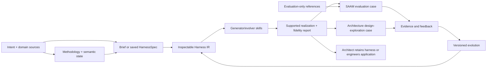
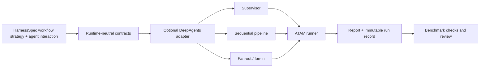

# HarnessWeaver U4-U7 Implementation Plan - Plan

## Goal Capsule

- **Objective:** Complete roadmap units U4-U7 by making intent, domain knowledge, methodology, and semantic state explicit in the generated Harness IR; validating it against architecture evaluation and design exploration; and testing supported realization and evolution paths.
- **Means:** Finish U4, then deliver and compare the ATAM Claude plugin and DeepAgents runtime prototype in U7. Treat the WRCS SAAM evaluation (U5) and architecture design-exploration case (U6) as separate later cases; they do not gate the ATAM demo.
- **Authority:** `STRATEGY.md` sets product direction; `CONCEPTS.md` defines shared terminology; `docs/harnessweaver-implementation-roadmap.md` is the product source and is updated alongside this plan when direction changes.
- **Stop condition:** Each unit has traceable artifacts and verification evidence; the evaluation pilot discloses partial SAAM reference data; the exploration case uses its own declared review criteria; both record failures and human intervention; standalone case studies remain intact unless ownership and provenance authorize a change.
- **Sequencing:** U4 → U7 (ATAM Claude plugin and DeepAgents demonstration) → U5 (separate WRCS SAAM evaluation case) and U6 (separate architecture design-exploration case). SAAM is not the ATAM prototype and does not gate the ATAM demonstration.

## Product Contract

### Summary

HarnessWeaver separates intent, domain knowledge, methodology, and domain-semantic methodology state from the agents and runtime that enact them. A proportionate saved HarnessSpec is useful for reusable or complex work, while a simple one-off may use a lightweight brief. This plan covers the work after the initial inventory, spec, and Python validator (U1-U3): generator/evolver behavior, separate evaluation and design-exploration case studies, and bounded materialization/evolution across supported realization paths. HarnessWeaver currently aims to generate and evolve viable prototypes; it does not search for or select an optimal harness.

### Requirements

- R1. Harness and evolve skills use HarnessSpec for reusable or complex harnesses, with provenance and domain materials preserved; allow a simple one-off to proceed without a saved spec when the spec overhead outweighs its value.
- R2. Shared skill guidance stays portable; runtime-specific paths and behavior are isolated and unsupported or lossy mappings are reported.
- R3. The SAAM evaluation pilot compares a baseline and spec-guided harness on matched inputs/settings, keeping reference outputs out of generation and accurately representing the partial source extraction.
- R4. Evaluation reports deterministic structure, domain quality, expert judgment, and operational cost separately. Similarity and LLM-judge scores remain supporting signals.
- R5. Every run records input, spec, harness, runtime/model configuration, results, and feedback sufficiently to reproduce or explain it.
- R6. Architecture design exploration is modeled as a distinct methodology, with its own design inputs, decision artifacts, evaluation criteria, and expert review.
- R7. Portability and evolution scenarios retain baselines, disclose fidelity gaps, and compare revisions under the same evaluation protocol.
- R8. Keep the first proof in software architecture evaluation and design exploration; preserve the roadmap’s scope boundaries, case-study provenance, and existing research/ground-truth data.
- R9. Let an architect select supported workflow coordination strategies and agent interaction styles as separate HarnessSpec concerns; each runtime adapter reports supported combinations and unsupported or approximated behavior for both.

### Scope Boundaries

Included: canonical skill-source and synchronization rules; explicit methodology and semantic state in generated Harness IR; saved-spec and lightweight one-off paths; a bounded SAAM evaluation pilot; an ADD/ReArch-informed design-exploration case; a reusable DeepAgents runtime boundary and three workflow strategies plus supported agent interaction styles exercised against the same ATAM harness; one evidence-linked evolution comparison for each selected case.

Deferred: a general-purpose, user-authored workflow engine; persistent Claude-style agent messaging and task-list semantics; broad automatic generation; multi-domain benchmark claims; full case-study consolidation; autonomous optimization; and provider/model selection loops. Do not rebuild the software-architecture-agent UI or change evaluation ground truth.

## Planning Contract

### Key Technical Decisions

- KTD1. The implementation roadmap and this execution plan are kept aligned; this update changes both because the user provided the conversation context and research assets.
- KTD2. Use the SAAM WRCS revision-control case as a separate later bounded evaluation pilot, after the ATAM prototype demonstration. Its JSON extraction is partial (six of fifteen scenarios represented, with some inferred fields), so accuracy scoring is restricted to known references and claims stay case-scoped.
- KTD3. Compare baseline and HarnessWeaver-guided variants under matched inputs and settings. Keep generation inputs separate from the evaluator's reference outputs; record unavoidable differences.
- KTD4. Keep generator inputs and evaluation-only ground truth in separate paths and permissions. Blind reviewers see anonymized arm labels until their scores are locked.
- KTD5. Keep method-derived procedure distinct from HarnessWeaver's agent-specific adaptations. Report fidelity and semantic loss for each runtime; do not treat a runtime-neutral IR as proof of equivalent execution.
- KTD6. Treat `harness-en/skills/` as the current active harness/evolve skill tree. The root README and `harness-en/README.md` still describe removed `skills/` and `packages/harness-en/` locations; correct those ownership and install references as part of U4. Recheck for other copies before editing, and retain English-first guidance.
- KTD7. Keep runtime selection as an architect choice among supported forms. DeepAgents and skills are realization paths, not competing definitions of HarnessWeaver; report actual capability and fidelity limits.
- KTD8. Store each attempt in a distinct immutable run directory with a manifest. Partial or failed runs remain recorded but do not count as a quality comparison. Missing cost data is unavailable, never zero.
- KTD9. U6 may change nested case-study application source only after U1’s ownership/provenance boundary is established. First reconcile the Stage 1 `user_id`/`project_id` call mismatch; do not touch research inputs or ground truth.
- KTD10. Store the selected workflow strategy and agent interaction style in HarnessSpec for now, with run-time CLI overrides for controlled comparisons (session-settled: user-approved — chosen over a runtime-only default so the harness design records its intended coordination while comparisons can reuse one spec).
- KTD11. Model workflow coordination separately from agent interaction. Begin with three workflow strategies: `supervisor`, `sequential_pipeline`, and `fan_out_fan_in`; declare agent interaction independently, validate only supported pairings, and keep the two dimensions distinct so workflow control is not confused with how agents exchange work/results.
- KTD12. Keep runtime contracts in `src/harnessweaver/runtime/` and DeepAgents-specific construction in `src/harnessweaver/adapters/deepagents/`; optional backend dependencies must not be required to load or validate a HarnessSpec. Declare DeepAgents and LangGraph in the optional backend dependency set because the fan-out/fan-in adapter relies on LangGraph graph execution.
- KTD13. Treat persistent Claude-style agent-to-agent messaging and shared task-list collaboration as unsupported in the initial DeepAgents adapter; use explicit typed/artifact handoffs or one-shot subagent delegation and record that fidelity boundary.

### High-Level Technical Design

The workflow identifies intent, domain assets, and methodology from supplied material. Depending on task complexity, the input is a lightweight brief or a saved HarnessSpec. The generator creates a Harness IR with activities, readiness, artifacts, verification, completion, and semantic state; Python validates saved forms. U4 establishes that representation. U7 first demonstrates the ATAM harness through Claude plugin and DeepAgents forms, compares supported DeepAgents workflow strategies while holding agent interaction style constant, records fidelity, and applies evidence-linked evolution while preserving baselines. U5 and U6 then test the representation in separate SAAM evaluation and architecture design-exploration cases.

U7 keeps reusable orchestration contracts separate from the optional DeepAgents adapter and the ATAM domain runner. Workflow coordination and agent interaction are separate HarnessSpec dimensions:

## Implementation Units

### U4. Make methodology and semantic state first-class in generator/evolver

- **Goal:** Generate an inspectable Harness IR from intent, domain assets, and methodology, with semantic methodology state distinct from agent/runtime state.
- **Files:** `harness-en/skills/harness/SKILL.md`, `harness-en/skills/evolve/SKILL.md`, their references, `specs/harnessspec/`, `README.md`, `README_EN.md`, `harness-en/README.md`, `docs/consolidation-plan.md`, and focused scenario fixtures.
- **Approach:** Treat `harness-en/skills/` as the current active source unless repository evidence reveals another maintained copy. Correct docs that still refer to removed paths. Identify intent, domain, methodology, and runtime constraints in supplied material. Create a proportionate HarnessSpec for reusable/complex work, but allow a simple one-off to use a lightweight brief. Generate an IR that models activities, readiness, artifacts, validation, completion, evidence, gaps, and semantic state. Assess whether schema v0.1 can represent these concepts; if not, introduce a versioned extension while preserving v0.1 validation. Keep checker, verifier, and evaluator responsibilities clear without requiring separate agents. Evolution classifies feedback by layer and preserves baselines/provenance. Materialize only supported outputs and report fidelity limits.
- **Test scenarios:** A simple one-off works without a saved spec; a reusable architecture task produces explicit methodology and semantic progress; supplied sources retain provenance; conflicts and missing evidence are surfaced; runtime execution bookkeeping is not treated as methodology progress; feedback changes the appropriate layer.
- **Verification:** Run focused skill scenarios and Python validator checks in the `harness` Conda environment. Inspect artifacts against the v0.1 example and any versioned extension; verify README/install/documentation paths resolve to the active tree.
- **Depends on:** U2 and U3.

### U5. Pilot architecture evaluation on the partial-reference SAAM case

- **Goal:** Test whether the intent/domain/methodology/state representation produces a useful architecture-evaluation prototype with evidence-grounded outputs.
- **Files:** HarnessWeaver-owned benchmark configuration, immutable run manifests/artifacts, deterministic check definitions, and pilot report. Inspect `case-studies/architecture-eval/SAAM/data/revision_control_system.json` as the bounded source; use existing architecture-evaluation execution and human-review assets only where their method and case match. Keep source inputs and ground truth unchanged.
- **Approach:** Use `case-studies/architecture-eval/SAAM/data/revision_control_system.json` as a bounded, separate SAAM case; the first-version ATAM demo is delivered through the Claude plugin and DeepAgents backend under U7. Respect the SAAM source's `completeness: Partial` metadata: only six of fifteen scenarios are represented and some fields are inferred. Give generation `evaluation_inputs` plus the six source scenario IDs/texts needed to analyze the case; keep classifications, impact assessments, and all other reference outputs evaluator-only. Score only represented facts and outputs, mark missing data unknown, and compare baseline/guided arms under matched settings. Record run manifests and human review; latency/cost may be unavailable and must not be recorded as zero.
- **Test scenarios:** Both arms have complete manifests; outputs pass contract/artifact checks; represented SAAM scenario references and evidence links are checked deterministically; reviewers assess method completeness and evidence-grounded reasoning; failed/partial runs are traceable but excluded from paired quality claims.
- **Verification:** Produce one baseline and one guided run on the same case. Report structural checks, scenario coverage, evidence support, expert judgments/disagreement, omissions, time/change effort, and available cost/latency. Define metric procedures during the pilot; disclose missing ground truth and avoid generalization from this single case. Similarity and LLM-judge results are supplementary.
- **Depends on:** U2, U3, and U4.

### U6. Define and review an architecture design-exploration case

- **Goal:** Determine whether the representation covers design exploration as a distinct methodology, rather than treating all architecture work as evaluation.
- **Files:** HarnessWeaver-owned design-exploration profile and review criteria; sources in `docs/research-foundations.md`, especially the ADD, ReArch, and LLM design-assistant papers.
- **Approach:** Define the design task, drivers, alternatives, decisions/rationale, required views/artifacts, iteration, human review, and quality criteria. Identify which steps come from ADD or ReArch and which are HarnessWeaver adaptations. Do not treat published example outputs as ground truth for a new scenario; obtain expert review and record critical unresolved choices.
- **Test scenarios:** The IR can represent alternative generation and comparison, rationale and evidence, iteration, and human decisions without forcing the ATAM/SAAM evaluation flow; reviewers can flag vague, duplicated, or unsupported recommendations.
- **Verification:** Produce a source-traceable method mapping and a reviewed prototype comparison under criteria declared before generation. State the case and method limits.
- **Depends on:** U2 and U4; U5 informs review-recording practice.

### U7. Materialize and evolve the prototypes across supported realization paths

- **Goal:** Establish a reusable runtime boundary and compare supported DeepAgents workflow strategies on the same ATAM harness while making agent interaction style an independent, recorded choice, before extending materialization to other cases.
- **Files:** `src/harnessweaver/runtime/`, `src/harnessweaver/adapters/deepagents/`, `src/harnessweaver/spec.py`, `specs/harnessspec/v0.2.schema.json`, `pyproject.toml`, `examples/atam/harnessspec.yaml`, `examples/atam/deepagents/atam_harness/`, `examples/atam/deepagents/run.py`, `benchmarks/atam/pilot.py`, `tests/test_spec.py`, `tests/test_runtime.py`, `tests/test_deepagents_runtime.py`, and `tests/test_atam_demo.py`.
- **Approach:** Add versioned workflow-strategy and agent-interaction declarations to HarnessSpec as separate fields. Preserve v0.1 loading and validation, and reject unknown or unsupported combinations with actionable errors. The spec supplies defaults; CLI overrides support controlled comparisons and are recorded as effective run configuration. Keep `src/harnessweaver` importable without DeepAgents or LangChain by placing backend imports behind the optional adapter. Declare DeepAgents and LangGraph in the optional backend dependency group; LangGraph provides the fan-out barrier and synthesis graph, using its shared-state and parallel-node semantics ([Graph API](https://docs.langchain.com/oss/python/langgraph/graph-api)), while DeepAgents supplies context-isolated specialist delegation ([DeepAgents subagents](https://docs.langchain.com/oss/python/deepagents/subagents)). Define typed, runtime-neutral run/result contracts; keep Pydantic report models and ATAM report composition inside the ATAM boundary. Start with these explicitly supported profiles: `supervisor` plus one-shot specialist delegation; `sequential_pipeline` plus typed artifact handoffs between declared ATAM stages; `fan_out_fan_in` plus parallel specialist delegation and a typed result join before ATAM synthesis and evidence review. Keep the two HarnessSpec fields separate, but validate only these supported combinations in the first adapter; no persistent peer-to-peer collaboration is claimed. Keep streaming and verbosity as orthogonal presentation settings. Preserve ATAM methodology, role definitions, domain skills, evidence boundary, and report schema across strategies; strategy-specific orchestration instructions may differ. Keep `benchmarks/atam/runs/` as run data, with the execution entry point in `benchmarks/atam/` or the existing example runner. Record each run's effective strategy and interaction style, input/spec fingerprints, model/runtime settings, status, output path, and available timing/cost without secrets. Report unsupported Claude semantics such as persistent agent messaging, workflow resume/cache/budget behavior, and majority-vote verification rather than implying equivalence.
- **Test scenarios:** A v0.1 spec remains valid and a v0.2 spec accepts the three supported strategy/interaction profiles while rejecting typos and unsupported combinations; core spec validation imports without optional runtime dependencies. Fake-agent tests prove pipeline order and artifact handoffs, fan-out branch completeness and join behavior, and supervisor delegation without provider calls. Required-branch failures stop report publication and leave a failed run record; successful profiles produce the same Pydantic ATAM report contract. Streaming and non-streaming execution produce equivalent final reports. The runner passes only `evaluation_inputs`; CLI overrides change the effective strategy or interaction style without mutating the source spec. Concurrent runs receive separate output paths and manifests. One ATAM run per profile uses the same case, model, prompts, skills, and report contract; deterministic structure checks, scenario coverage, evidence grounding, latency, and available cost are recorded separately. Results compare the profiles as complete orchestration choices rather than attributing differences solely to workflow strategy; model variation and missing references are disclosed.
- **Verification:** Run schema and runtime unit tests with fake agents, then perform one provider-backed ATAM run for each supported profile using the `harness` Conda environment. Compare the outputs with `benchmarks/atam/pilot.py` deterministic checks and the case-specific review protocol; keep trials as distinct immutable run records. Report failures, partial runs, capability gaps, semantic loss, and regressions. Do not use this single case to claim general quality improvement or full Claude/DeepAgents equivalence.
- **Depends on:** U4.

## Verification Contract

| Gate | Applies to | Evidence required |
|---|---|---|
| Skill conformance | U4 | Scenario results, spec-valid outputs, provenance retained, canonical source/mirror consistency, explicit unsupported-capability report. |
| Benchmark integrity | U5 | Paired manifests and settings, generator/evaluator data separation, deterministic checks, locked blind review, immutable run records. |
| Evaluation and exploration validity | U5, U6 | Source-derived criteria, human review, partial references and unknowns disclosed, generation/evaluation data separated. |
| Runtime modes and adapter fidelity | U7 | Workflow strategy and agent interaction resolve independently from HarnessSpec or explicit overrides; capability gaps, unsupported behavior, semantic loss, and methodology/state mapping are recorded. |
| Evolution quality | U7 | Feedback-linked change, preserved baseline, same-protocol comparison, improvement/regression evidence. |

Use `conda run -n harness ...` for project Python commands, as required by `AGENTS.md`. Do not run model-based cases without recording model/runtime settings. Do not change standalone case-study source, research inputs, or ground truth before ownership and provenance are established.

## Definition of Done

- Harness and evolve skills consume HarnessSpec coherently, with a documented canonical source and reproducible mirror policy.
- Baseline and HarnessWeaver-guided SAAM runs have immutable manifests and disclose partial reference data and unknowns.
- An architecture design-exploration case has a source-traceable method mapping, declared review criteria, and expert-reviewed prototype results.
- The shared runtime remains optional-backend-safe; the optional DeepAgents/LangGraph adapter runs the ATAM harness in supervisor, sequential-pipeline, and fan-out/fan-in workflow strategies, with agent interaction declared separately, under one output contract.
- Mode-specific runs record effective configuration and can be checked and compared with the existing ATAM benchmark protocol; capability coverage and semantic loss are reported.
- Any nested application change respects established ownership.
- Evidence-linked evolution comparisons preserve original baselines and use the same case-specific criteria.
- Results state the tested scope and limitations; no broad quality claim rests on the single-case pilot.
- `docs/harnessweaver-implementation-roadmap.md` remains the product source and stays aligned with this execution plan.
