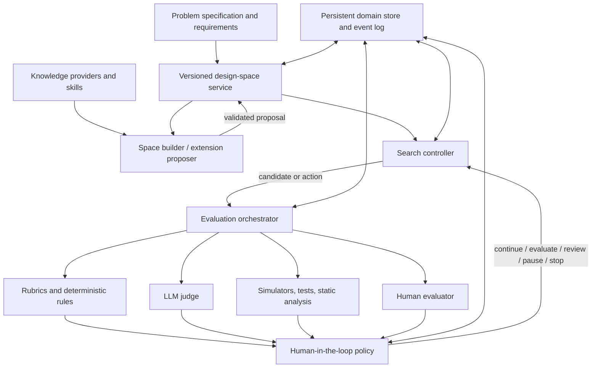

# Software Design Exploration Agent Harness
## Consolidated Vision, Architecture, Domain Model, and Prototype Implementation Specification

**Document status:** Working specification for the first prototype  
**Version:** 0.1  
**Date:** 2026-10-10  
**Primary implementation runtime:** DeepAgents  
**Team-design/prototyping aid:** `revfactory/harness`  
**Domain:** Software design and architecture exploration

---

## 1. Executive summary

This project aims to build a modular Agent Harness that systematically explores alternative software designs from an initial context, requirements, constraints, and quality goals.

A solution is represented as a structured set of **design decisions**, not merely as a block of generated prose. The harness maintains an explicit, evolving design space whose dimensions represent design questions and whose values represent possible decisions. Search strategies explore assignments in this space, while pluggable evaluation methods assess decisions, interactions, partial designs, complete solutions, and sets of alternatives.

The implementation should primarily use **DeepAgents** for agent execution, delegation, skills, tools, and resumable workflows. The `revfactory/harness` repository can help prototype the agent team, skills, orchestration patterns, and verification workflows before these are adapted to DeepAgents. It is a team-design aid, not the authoritative domain model or a required runtime dependency.

The domain model and core services must remain independent of the agent framework. The application—not an agent's conversational state—owns the authoritative design space, candidates, assessments, constraints, review policy, and run history.

The first prototype should be deliberately small and testable. It should use a predefined design space, deterministic candidate enumeration and constraint checks, a simple rubric, persistence, and one end-to-end design scenario. Dynamic space extension, LLM judging, human review, subagents, and more advanced search should be introduced incrementally behind explicit interfaces.

### Core principles

1. **Decisions are first-class:** candidates are structured assignments of values to design dimensions.
2. **The design space is explicit and versioned:** its construction and evolution are separate from search.
3. **Search is replaceable:** enumeration is the baseline; more advanced strategies can be added later.
4. **Evaluation is pluggable:** rules, rubrics, LLM judges, simulators, static analysis, and human judgment share an assessment contract.
5. **Human involvement is policy-driven:** explicit rules decide when to continue, gather evidence, request review, pause, escalate, or stop.
6. **Agents propose; domain services validate and commit:** agents do not directly mutate authoritative state.
7. **History is reproducible:** candidates, space versions, evaluations, evidence, configuration, and workflow events are persisted.
8. **The prototype grows incrementally:** each milestone produces a working, testable system.

---

## 2. Goals and non-goals

### 2.1 Goals

The harness should:

- Accept a problem context, requirements, constraints, and quality attributes.
- Represent a software design space as dimensions, values, dependencies, applicability rules, and constraints.
- Represent a candidate as a partial or complete set of design decisions.
- Explore multiple alternatives rather than immediately committing to one generated design.
- Evaluate designs at multiple levels: decision, decision interaction, partial candidate, complete candidate, and set of candidates.
- Combine hard constraints with qualitative and quantitative evaluation.
- Support evaluation plans that select and coordinate different evaluators.
- Support configurable human-in-the-loop policies.
- Consult external knowledge sources such as Wiki pages, RAG repositories, PDFs, and other document stores.
- Use reusable skills for architecture analysis and evaluation procedures.
- Preserve provenance and enable paused runs to resume.
- Use DeepAgents as the primary agent runtime while keeping the domain framework-independent.
- Use `revfactory/harness` to help shape an initial team and skill catalog, where useful.
- Compare a single-agent baseline with multi-agent variants under controlled conditions.

### 2.2 Non-goals for the first prototype

The first prototype does not need to:

- Support every software architecture domain.
- Implement a sophisticated universal design-space language.
- Start with MCTS, genetic algorithms, or a general optimization framework.
- Create an autonomous agent for every responsibility.
- Treat every evaluation as a scalar score.
- Automatically accept every LLM-proposed dimension or constraint.
- Build a general-purpose workflow engine.
- Depend on `revfactory/harness` at runtime.
- Allow agents to execute arbitrary code or arbitrary constraint expressions.
- Guarantee that an LLM judge is correct merely because it returns a structured score.

---

## 3. Conceptual architecture

The system is organized into separate logical modules. The initial deployment can be one Python application; separate microservices are unnecessary.



### 3.1 Responsibilities by subsystem

| Subsystem | Responsibility | Must not own |
|---|---|---|
| Domain model | Defines problem, space, decisions, candidates, assessments, and runs | Agent execution |
| Design-space service | Validates and versions dimensions, values, dependencies, and constraints | Search strategy |
| Space builder | Proposes dimensions, values, and refinements from requirements and knowledge | Direct mutation of authoritative state |
| Search controller | Selects what to explore next and manages exploration budgets | Evaluator internals |
| Evaluation orchestrator | Runs evaluation plans and collects assessments | Search-policy decisions beyond its contract |
| Evaluators | Produce assessments using a specific method | Overall search control |
| Human-in-the-loop policy | Decides what should happen after assessment | Rubric internals or domain storage implementation |
| Knowledge providers | Retrieve documents and evidence | Authoritative design-space mutation |
| DeepAgents runtime | Executes agents, tools, skills, and delegation | The definition of the design domain |
| Persistence and event log | Store domain objects, versions, assessments, and events | LLM reasoning itself |

### 3.2 Separation of concerns

Keep three decisions separate:

- **Evaluation:** What does the available evidence say about this design?
- **Search:** Which design or decision should be explored next?
- **Human-in-the-loop policy:** Is automation sufficient, is more evidence needed, or must a person intervene?

Search can use assessments to prioritize candidates. The human policy can request additional evaluations. Neither should own the criteria themselves.

---

## 4. Domain model

The domain model is the core of the project and must not depend on DeepAgents-specific types.

### 4.1 `ProblemSpec`

Represents the design problem being explored.

Fields:

- `id`: stable identifier.
- `version`: problem-specification version.
- `title`: concise problem name.
- `context`: description of the system and environment.
- `requirements`: functional requirements, quality goals, and constraints.
- `stakeholders`: optional stakeholder roles or preference sources.
- `source_refs`: references to input documents and knowledge sources.
- `created_at`: timestamp.
- `metadata`: optional non-authoritative metadata.

Requirements should have stable IDs, descriptions, types, and source references. Requirements can include functional behavior, quality attributes, mandatory constraints, preferences, and assumptions. Do not treat a preference as a hard constraint unless explicitly specified.

### 4.2 `DesignSpace`

Represents a versioned collection of dimensions and alternatives.

Fields:

- `id`
- `version`
- `dimensions`
- `constraints`
- `created_at`
- `parent_version` or equivalent change lineage
- `change_summary`
- `provenance`

A space version is immutable after publication. Extensions create a new version. A draft proposal can be validated before it becomes a published version.

### 4.3 `Dimension`

Represents a design question, such as “How do components communicate?”

Fields:

- `id`
- `question`
- `description`
- `values`
- `depends_on`
- `applicability`
- `provenance`
- `status`

Examples:

- Communication style.
- Deployment topology.
- Persistence technology.
- Consistency model.
- Authentication approach.
- Failure-recovery strategy.

`depends_on` and `applicability` need explicit semantics. For the first prototype, dependencies may be simple references and applicability may be evaluated by a small, safe predicate interface. Do not evaluate arbitrary Python expressions supplied by an LLM.

### 4.4 `DesignValue`

Represents one alternative for a dimension.

Fields:

- `id`
- `description`
- `rationale`
- `consequences`
- `compatibility_conditions`
- `obligations`
- `evidence_refs`
- `provenance`
- `status`

A value can have consequences and obligations that become relevant when other decisions are made. For example, selecting asynchronous messaging may create obligations around delivery guarantees, retries, idempotency, and observability.

### 4.5 `DesignConstraint`

Represents a rule governing valid assignments or candidate quality.

Fields:

- `id`
- `description`
- `kind`: for example, compatibility, requirement, policy, or quality threshold.
- `hard`: whether violation makes a candidate infeasible.
- `expression` or registered validator ID.
- `scope`: dimension, interaction, partial candidate, or complete candidate.
- `provenance`.

Hard constraints must be distinguished from preferences. Constraints should be implemented through a controlled set of registered validators or a safe expression language. Never execute arbitrary generated strings as Python.

### 4.6 `Candidate`

Represents one partial or complete design.

Fields:

- `id`
- `space_id`
- `space_version`
- `assignments`: mapping from dimension ID to value ID.
- `status`: `partial`, `complete`, `infeasible`, or `evaluated`.
- `parent_id`: optional parent candidate when branching.
- `created_by`: strategy or agent identifier.
- `created_at`
- `metadata`

Every candidate must reference the exact space version under which it was constructed. A candidate is complete when all applicable required dimensions have assignments. Partial candidates are permitted and are useful for incremental search.

A candidate's assignments are structured data. Natural-language explanations may be stored alongside them, but must not replace the assignments.

### 4.7 `Assessment`

Represents the result of evaluating a target.

Fields:

- `id`
- `target_type`: `decision`, `interaction`, `candidate`, or `candidate_set`.
- `target_id`
- `criterion_id`
- `rubric_version`, if applicable.
- `evaluator_type`
- `evaluator_config_version`
- `status`: `completed`, `insufficient_evidence`, or `failed`.
- `value`: optional scalar result.
- `scale` and `units`, where relevant.
- `rationale`
- `evidence_refs`
- `uncertainty`
- `created_at`

Assessments should be append-only. Reassessment produces a new record rather than overwriting historical evidence.

A measured latency, a static-analysis result, an LLM opinion, and a human preference are different evidence types. Do not assume that they are directly comparable just because they can all be represented numerically.

### 4.8 `SearchRun`

Represents an exploration session.

Fields:

- `id`
- `problem_id` and version.
- `space_id` and initial space version.
- `strategy_id` and configuration.
- `evaluation_plan_id` and version.
- `status`: `created`, `running`, `paused`, `completed`, or `failed`.
- `candidate_ids` or a repository query reference.
- `budget`: optional limits on time, model calls, or evaluator calls.
- `checkpoint_ref`
- `created_at`, `updated_at`
- `termination_reason`

The run should record later space versions that it adopted, rather than silently replacing its original space version.

### 4.9 Supporting models

The first prototype may keep these simple:

- `Rubric`: criteria, scales, evidence requirements, thresholds, aggregation rules, and version.
- `EvaluationPlan`: evaluator sequence, conditions, and aggregation policy.
- `HumanReviewRequest`: target, question, context, requested reviewer role, status, and response reference.
- `SpaceExtensionProposal`: proposed changes, rationale, evidence, and validation status.
- `RunEvent`: an append-only event describing a meaningful state transition.

---

## 5. Design-space semantics

### 5.1 Cartesian product and feasibility

For dimensions \(D_1,\ldots,D_n\), the raw space is:

\[
\mathcal{D}=D_1\times D_2\times\cdots\times D_n
\]

The Cartesian product describes all syntactic combinations. The actual feasible set is the subset satisfying applicability rules, dependencies, and constraints.

This distinction is essential: a dimension may be irrelevant under some assignments, and some combinations may be incompatible.

### 5.2 Partial assignments

Search should support partial assignments. A partial candidate can be valid even when it is not yet a complete solution.

For partial candidates, validation should distinguish:

- Definitely invalid.
- Currently consistent but incomplete.
- Complete and feasible.
- Complete but infeasible.
- Unable to determine because required evidence is missing.

Do not reject a partial candidate merely because a constraint cannot be fully evaluated yet. Instead, represent the result as unresolved when appropriate.

### 5.3 Dynamic space evolution

The initial space can be predefined, generated from requirements, or assembled from a small architecture-pattern catalog. During exploration, an agent may identify a missing design question or a useful alternative.

The agent submits a `SpaceExtensionProposal`. A domain service then:

1. Validates schema and references.
2. Checks dimension and value IDs.
3. Checks dependency and constraint consistency.
4. Records rationale and provenance.
5. Accepts, rejects, or requests human approval.
6. Publishes a new immutable space version if accepted.
7. Marks affected candidates for possible reassessment.

The search algorithm must not directly mutate the authoritative space.

### 5.4 Stable identifiers and versioning

Use stable IDs for dimensions, values, constraints, criteria, and evaluators. Avoid relying on display names as keys.

When a value is deprecated or a dimension is refined, preserve the old version. Decide explicitly whether candidates in the old version remain comparable, require migration, or need reassessment.

---

## 6. Search subsystem

### 6.1 Search contract

The search subsystem should be replaceable through a small protocol. A strategy consumes the current problem, a space snapshot, candidate and assessment summaries, and the remaining budget. It returns a proposed next action.

Potential actions include:

- Create or expand a candidate.
- Assign a value to an unresolved dimension.
- Request evaluation.
- Request a space extension.
- Revisit a branch.
- Finish the run.

The application validates and executes the action. A search strategy does not write directly to repositories.

### 6.2 Initial strategy

Start with deterministic enumeration over a small finite space. If the space is too large, use bounded enumeration or seeded random sampling.

Enumeration provides a baseline against which more sophisticated strategies can be compared. It also helps validate the domain model and constraint semantics independently of agent behavior.

### 6.3 Later strategies

Add only when the baseline reveals a need:

- Greedy search.
- Monte Carlo Tree Search (MCTS).
- Beam search.
- Evolutionary search.
- Multiobjective optimization and Pareto-frontier maintenance.
- Surrogate models for expensive evaluation.

Search strategy should be independent of whether evaluations are provided by rules, an LLM, a simulator, or a human.

### 6.4 Multiobjective evaluation

Avoid forcing every design objective into a single weighted score by default. Preserve per-criterion assessments and support hard feasibility constraints plus multiple quality objectives.

For multiple objectives, maintain a Pareto set of nondominated candidates when appropriate. Stakeholder preferences or human comparisons may be needed to select among Pareto-optimal designs.

---

## 7. Evaluation subsystem

### 7.1 Evaluation targets

The system should support:

1. Individual decisions.
2. Interactions between decisions.
3. Partial candidates.
4. Complete candidates.
5. Sets of candidates, including diversity and Pareto trade-offs.

Decision-level assessments must not automatically be summed to create a candidate-level score. A decision's effect may depend on other decisions, and a quality attribute may otherwise be double-counted.

### 7.2 Evaluator types

| Evaluator | Typical use | Caveat |
|---|---|---|
| Deterministic rules | Constraint and compatibility checks | Only covers encoded rules |
| Rubric evaluator | Consistent criterion-based assessment | Depends on rubric and evidence quality |
| LLM judge | Qualitative critique and structured comparison | May be inconsistent, biased, or poorly calibrated |
| Simulator | Performance, load, reliability scenarios | Depends on model fidelity |
| Static analysis | Code or architecture rules | Depends on available artifacts and rule coverage |
| Tests and benchmarks | Executable outcomes | Coverage can be incomplete |
| Human evaluator | Expertise, preferences, ambiguous trade-offs | Has time cost and potential reviewer variance |

Each evaluator should implement a common contract, declare what target types it supports, and return structured assessments.

### 7.3 Rubrics

A rubric is a versioned artifact, not just a prompt.

It should define:

- Criterion IDs and descriptions.
- Assessment scales and anchors.
- Required evidence.
- Thresholds.
- Aggregation rules.
- Whether the criterion is a hard gate or a preference.
- Version and provenance.

For example, a reliability rubric might assess fault isolation, recovery behavior, and evidence from failure-mode analysis or simulation. A minimum threshold may be mandatory even if other criteria score highly.

### 7.4 Evaluation plans

An evaluation plan chooses which evaluators to run, in which order, and under which conditions.

Example plan:

1. Run deterministic feasibility checks.
2. Reject candidates that violate hard constraints.
3. Run simulations for feasible candidates.
4. Use an LLM judge to assess maintainability against a rubric.
5. Ask for human comparison if several nondominated candidates remain and the trade-off depends on stakeholder priorities.

Expensive evaluators should be invoked selectively where possible.

### 7.5 Assessment aggregation

Aggregation must preserve the meaning and provenance of each result. Do not combine incompatible units or evidence types without an explicit, documented rule.

Distinguish:

- Hard constraint violation.
- Negative preference assessment.
- Insufficient evidence.
- Evaluator failure.
- Unresolved disagreement.

Insufficient evidence must not silently become either a failing score or a passing score.

---

## 8. Human-in-the-loop policy

### 8.1 Policy responsibility

The human-in-the-loop policy is a configurable decision component, not another autonomous agent. It consumes run state, assessment results, uncertainty, impact, and budget information and returns an explicit next action.

Suggested actions:

- `CONTINUE`
- `RUN_EVALUATOR`
- `REQUEST_REVIEW`
- `REQUEST_COMPARISON`
- `ESCALATE`
- `PAUSE`
- `STOP`

### 8.2 Policy triggers

A policy may use combinations of:

- Threshold-based triggers.
- Low confidence or missing evidence.
- Disagreement between evaluators.
- Novel or unsupported architectural patterns.
- High-impact or difficult-to-reverse decisions.
- Evaluation budget limits.
- Remaining Pareto trade-offs.
- Mandatory approval requirements.
- Scheduled batch review.

For example, uncertainty on a low-impact reversible decision may trigger another automated evaluation. Uncertainty on a consequential, difficult-to-reverse decision may require expert review.

### 8.3 Human review workflow

The application should create a persistent `HumanReviewRequest`, pause the relevant workflow, and resume it when a response arrives. The human response becomes a versioned assessment with rationale and provenance.

Do not rely on an agent's transient conversation history to remember a pending review.

### 8.4 DeepAgents and workflow interrupts

Use the appropriate DeepAgents/LangGraph mechanisms for interrupts and checkpointed execution. Keep the domain review request and its status in the application's persistent store. A workflow checkpoint and the authoritative domain record serve different purposes and must remain consistent.

---

## 9. Knowledge and skills

### 9.1 Knowledge providers

Define adapters for knowledge sources such as:

- Wiki pages.
- RAG repositories.
- PDFs and document collections.
- Architecture catalogs.
- Engineering standards and decision records.

Retrieved material should be represented as evidence with source references, relevant excerpts or summaries, and retrieval metadata. Preserve the difference between source evidence and an LLM-generated claim.

### 9.2 Skills

Skills should encode reusable procedures, such as:

- Identify design dimensions.
- Enumerate design alternatives.
- Analyze dependencies and compatibility.
- Compare architectural options.
- Assess quality attributes.
- Identify failure modes and design obligations.
- Review a proposed space extension.
- Identify unresolved trade-offs.

Each skill should specify its inputs, expected outputs, evidence requirements, and validation conditions. Skills can guide an agent, but deterministic rules and domain validators remain responsible for enforcing invariants.

### 9.3 Agent/runtime independence

The domain should not depend on a particular skill file format or agent framework. Adapt the chosen skill artifacts to the supported DeepAgents setup during migration.

---

## 10. Agent-team design using `revfactory/harness`

### 10.1 Purpose

Use `revfactory/harness` to explore and prototype the team architecture, agent roles, skills, orchestration patterns, and verification procedures. Treat its output as a design artifact to review and adapt, not as a required runtime dependency.

The repository's exact current features, output formats, and compatibility should be verified against the repository before implementation. Do not assume its generated artifacts can be imported directly into DeepAgents.

### 10.2 Initial agent team

Begin with three core roles:

#### Design-Space Architect

Responsibilities:

- Analyze the problem specification.
- Propose dimensions and values.
- Identify dependencies, applicability conditions, and constraints.
- Propose space extensions with rationale and evidence.
- Review whether the space covers meaningful alternatives.

Boundaries:

- Cannot mutate the authoritative space directly.
- Must provide structured proposals.
- Must distinguish sourced evidence from assumptions.

#### Design Explorer

Responsibilities:

- Explore partial and complete candidate assignments.
- Identify unresolved decisions.
- Request candidate evaluation.
- Identify when the current space may be insufficient.
- Report exploration progress and unresolved branches.

Boundaries:

- Does not own the search algorithm's persistent state.
- Does not bypass constraint validation.
- Does not invent evaluation results.

#### Design Evaluator

Responsibilities:

- Coordinate rubric-based qualitative assessment.
- Interpret simulator, test, and static-analysis results.
- Identify missing evidence and unresolved trade-offs.
- Produce structured assessment records or proposals for them.

Boundaries:

- Does not modify candidate assignments.
- Does not treat unsupported claims as evidence.
- Does not decide human approval requirements by itself.

### 10.3 Optional agents

Introduce these only when experiments demonstrate value:

- **Knowledge Analyst:** retrieves and synthesizes domain evidence.
- **Critical Reviewer:** challenges assumptions, looks for contradictions, and analyzes failure modes.

Knowledge retrieval, deterministic validation, persistence, and rubric execution should initially be ordinary tools or services, not separate agents.

### 10.4 Initial skill catalog

| Skill | Expected output |
|---|---|
| `identify-design-dimensions` | Proposed dimensions, questions, and rationale |
| `enumerate-design-alternatives` | Values, consequences, and evidence |
| `analyze-dependencies` | Proposed dependencies and compatibility conditions |
| `compare-architectural-options` | Structured trade-off comparison |
| `assess-quality-attributes` | Criterion-based assessment with evidence |
| `review-space-extension` | Validation findings for a proposed change |
| `identify-unresolved-tradeoffs` | Questions requiring more evidence or human judgment |

### 10.5 Framework-independent team specification

Keep a reviewed, framework-independent specification in version control:

```text
team_spec/
├── agents/
│   ├── space_architect.md
│   ├── design_explorer.md
│   └── design_evaluator.md
├── skills/
│   ├── identify-design-dimensions/
│   │   └── SKILL.md
│   ├── enumerate-design-alternatives/
│   │   └── SKILL.md
│   └── compare-architectural-options/
│       └── SKILL.md
├── workflows/
│   └── exploration.md
├── contracts/
│   ├── agent_io.md
│   └── tool_contracts.md
└── acceptance_tests/
    └── scenarios.md
```

This layout is a proposal for this project, not a claim about the repository's required format.

For each agent, specify mission, inputs, outputs, tools, skills, prohibitions, escalation rules, and completion criteria. For each skill, specify inputs, outputs, evidence requirements, and tests.

---

## 11. DeepAgents implementation plan

### 11.1 Runtime boundary

DeepAgents should run agents, provide tools and skills, support delegation, manage agent context, and integrate with the underlying LangGraph workflow and checkpoint mechanisms.

The application domain remains responsible for:

- Design-space versions.
- Candidate generation and validation.
- Evaluation plans and assessment records.
- Human-review policy.
- Search-run state and budgets.
- Authoritative persistence and provenance.

### 11.2 Tool design

Expose narrow, typed tools, for example:

- `get_problem_spec`
- `get_design_space_snapshot`
- `list_applicable_dimensions`
- `validate_candidate`
- `create_candidate`
- `propose_space_extension`
- `validate_space_extension`
- `publish_space_extension`
- `evaluate_candidate`
- `get_assessments`
- `request_human_review`

Tools should validate inputs and outputs and return structured results. Avoid giving agents unrestricted write access to the database or filesystem.

A proposal tool and a commit tool should be distinct. The proposal is untrusted until validated, and publication should enforce the applicable policy.

### 11.3 Start with a single-agent vertical slice

Before implementing a multi-agent team, build one DeepAgent with domain tools and a simple end-to-end scenario. This validates the domain model and runtime integration without adding delegation complexity.

Then add subagents only where there is a clear benefit. A subagent is not automatically better than a direct tool call.

### 11.4 Persistence

Use a small persistent domain store, such as SQLite, for the prototype. Use DeepAgents/LangGraph checkpointing for workflow state where appropriate, but do not confuse workflow checkpoints with the authoritative domain records.

Define recovery behavior for:

- A crash during evaluation.
- A pending human review.
- A space extension published while a run is paused.
- A candidate evaluated under an old space version.
- Repeated tool invocation after a retry.

Operations that may be retried should be idempotent where practical.

---

## 12. Suggested project structure

```text
design_harness/
├── domain/
│   ├── problem.py
│   ├── design_space.py
│   ├── candidate.py
│   ├── assessment.py
│   └── events.py
├── space/
│   ├── registry.py
│   ├── validation.py
│   ├── construction.py
│   └── extension.py
├── search/
│   ├── protocol.py
│   ├── enumeration.py
│   └── controller.py
├── evaluation/
│   ├── evaluator.py
│   ├── rubric.py
│   ├── plan.py
│   ├── orchestrator.py
│   └── aggregation.py
├── evaluators/
│   ├── rules.py
│   ├── llm_judge.py
│   ├── simulator.py
│   ├── static_analysis.py
│   └── human.py
├── human_loop/
│   ├── policy.py
│   ├── review_request.py
│   └── workflow.py
├── knowledge/
│   ├── protocol.py
│   └── retrieval.py
├── skills/
│   └── protocol.py
├── runtime/
│   └── deepagents_adapter.py
├── infrastructure/
│   ├── persistence.py
│   ├── event_log.py
│   └── model_client.py
├── team_spec/
│   ├── agents/
│   ├── skills/
│   ├── workflows/
│   └── acceptance_tests/
└── tests/
    ├── unit/
    ├── contract/
    ├── integration/
    └── scenarios/
```

This is a target structure, not a requirement to create every module on day one. The first implementation can combine small related modules until there is a reason to split them.

---

## 13. Incremental roadmap

### Stage 1 — Static design-space model

Implement:

- Problem and requirement models.
- Dimensions and values.
- Space versions.
- Candidate assignments.
- Hard constraints and basic validation.

Acceptance tests:

- Serialize and reload a space.
- Enumerate a small Cartesian product.
- Reject unknown dimension/value IDs.
- Distinguish partial, complete, and infeasible candidates.
- Verify that old space versions remain unchanged.

### Stage 2 — Baseline search and deterministic evaluation

Implement:

- Enumeration or bounded enumeration.
- Candidate creation and validation.
- One deterministic evaluator.
- A small rubric and assessment record.

Acceptance tests:

- Recover all feasible candidates in a small known space.
- Produce expected results for known test cases.
- Keep hard constraints separate from preferences.
- Preserve per-criterion assessments.

### Stage 3 — Persistence and run history

Implement:

- SQLite repositories.
- Search-run state.
- Append-only assessments and events.
- Checkpoint references and recovery behavior.

Acceptance tests:

- Resume an interrupted run.
- Reconstruct a candidate and its assessments.
- Verify that historical assessments are not overwritten.
- Test retry and idempotency behavior.

### Stage 4 — Harness team specification

Use `revfactory/harness` to prototype the initial team, skills, orchestration patterns, and verification procedures.

Review generated artifacts and translate the useful ideas into the framework-independent team specification. Verify actual output formats and assumptions against the repository.

Acceptance tests:

- Each role has explicit inputs, outputs, tools, and boundaries.
- Each skill has a defined output contract.
- Redundant roles and unnecessary delegation are removed.
- Team artifacts are versioned and reviewable.

### Stage 5 — DeepAgents vertical slice

Implement one DeepAgent with domain tools. Use the initial fixed space and deterministic evaluation.

Acceptance tests:

- Complete an end-to-end scenario.
- Ensure agents cannot bypass validation.
- Ensure structured assignments, not prose alone, define candidates.
- Persist all domain changes.

### Stage 6 — Subagents and skills

Add the Design-Space Architect and Design Evaluator as subagents where useful. Add the selected skills and knowledge retrieval.

Acceptance tests:

- Structured outputs satisfy schemas.
- Delegation failures are handled.
- Evidence references are retained.
- The single-agent baseline remains available for comparison.

### Stage 7 — Dynamic space extension

Add extension proposals, validation, approval rules, new versions, and reassessment triggers.

Acceptance tests:

- Reject malformed extensions.
- Reject inconsistent references and invalid constraints.
- Preserve old versions and candidates.
- Record provenance for accepted changes.
- Determine which existing candidates require reassessment.

### Stage 8 — Human-in-the-loop workflow

Add persistent review requests, interrupts, policy decisions, and resumable runs.

Acceptance tests:

- Pause on a review trigger.
- Persist the pending request.
- Resume after a human response.
- Record the response as a versioned assessment.
- Enforce mandatory approval rules.

### Stage 9 — Advanced exploration and evaluation

Add an LLM judge, simulator or external analyzer, multiobjective handling, Pareto-frontier maintenance, and later search strategies such as MCTS when needed.

Acceptance tests:

- Evaluator outputs conform to a common contract.
- Insufficient evidence remains distinct from failure.
- Search methods are compared under equal budgets.
- Candidate diversity and quality are measured.

---

## 14. First end-to-end scenario

Use a small architecture problem such as a notification service.

### Input

A Markdown specification contains:

- System context.
- Functional requirements.
- Expected workload.
- Reliability and latency goals.
- Infrastructure constraints.
- Relevant knowledge references.

### Initial space

| Dimension | Example values |
|---|---|
| Communication | Synchronous HTTP; asynchronous messaging |
| Deployment | Monolith; modular monolith; independent services |
| Persistence | Relational database; document database |
| Delivery guarantee | At-most-once; at-least-once |

This is intentionally small. In a realistic space, applicability and compatibility rules may restrict combinations.

### Execution

1. Load the problem specification.
2. Load a versioned design space.
3. Enumerate or sample candidate assignments.
4. Validate hard constraints.
5. Evaluate feasible candidates against a small rubric.
6. Identify a missing concern, such as idempotency or retry policy.
7. Propose and validate a space extension.
8. Publish the new space version if accepted.
9. Reassess affected candidates where needed.
10. Request human input if remaining trade-offs depend on stakeholder preferences.
11. Resume and produce a shortlist or Pareto set with evidence and unresolved questions.

### Expected outputs

- Versioned design space.
- Structured candidate assignments.
- Feasibility results.
- Per-criterion assessments.
- Evidence references.
- Space-extension history.
- Human-review history, if triggered.
- A traceable comparison of alternatives.

The prototype should not claim to have found the globally optimal design. It should report what it explored, what it evaluated, what it did not evaluate, and why the final alternatives were retained.

---

## 15. Testing and empirical validation

### 15.1 Test layers

- **Unit tests:** model validation, constraints, applicability, versioning, rubric logic, and policy decisions.
- **Contract tests:** interchangeable search strategies, evaluators, knowledge providers, and agent tools.
- **Integration tests:** persistence, runtime calls, tool validation, interrupts, and review workflows.
- **Scenario tests:** known design problems with expected feasible candidates and meaningful trade-offs.
- **LLM benchmark tests:** reference examples, expert agreement, prompt sensitivity, and evidence quality.
- **Search benchmarks:** compare strategies under equal model-call, evaluator-call, or time budgets.
- **Space-construction benchmarks:** compare a fixed space with an evolving space under the same search and evaluation setup.

### 15.2 Metrics

Measure more than a single aggregate score:

- Feasibility rate.
- Coverage of known relevant alternatives.
- Candidate diversity.
- Quality against each objective.
- Pareto-frontier quality, when applicable.
- Evaluation cost and latency.
- Number of tool calls and model calls.
- Human-review frequency and time.
- Percentage of claims supported by evidence.
- Reproducibility and recovery success.
- Number and impact of invalid space extensions.

### 15.3 Compare architectures experimentally

Compare at least:

1. Deterministic search with deterministic evaluation.
2. One DeepAgent with the same domain tools.
3. A multi-agent DeepAgents implementation.
4. Dynamic versus fixed design-space construction, when implemented.

Keep the problem, initial space, evaluation budget, and rubric consistent. This helps isolate whether added agents or dynamic space construction actually improve the results.

---

## 16. Risks and mitigations

| Risk | Mitigation |
|---|---|
| Agents mutate or corrupt the space | Proposal/validation/publication boundary |
| Space versions change candidate meaning | Immutable versions and explicit migration/reassessment |
| LLM judges invent evidence | Evidence references, structured outputs, independent checks |
| Incompatible metrics are combined | Typed assessment semantics and explicit aggregation rules |
| Too many agents create overhead | Start with one agent and add delegation only when justified |
| Search becomes uncontrolled text generation | Structured candidates and application-owned search state |
| Human reviews are lost on interruption | Persistent review requests and checkpointed workflows |
| Dynamic space grows without bound | Budgets, duplicate detection, review, and explicit stopping criteria |
| Agent framework lock-in | Framework-independent domain and team specifications |
| Search appears successful but misses important alternatives | Coverage/diversity metrics and benchmark scenarios |
| Evaluator disagreement is hidden by averaging | Preserve individual results and explicit disagreement policy |

---

## 17. Architectural decisions to preserve

1. The domain model must remain independent of DeepAgents.
2. The design space must be explicit, versioned, and independently evolvable.
3. A candidate must be a structured set of assignments.
4. Search strategies must be replaceable.
5. Evaluators must be pluggable and produce traceable assessments.
6. Rubrics and evaluation plans must be versioned artifacts.
7. Hard constraints must remain distinct from soft preferences.
8. Human-in-the-loop decisions must be policy-driven and testable.
9. Agents may propose changes, but domain services validate and commit them.
10. Workflow checkpoints must not replace authoritative domain persistence.
11. Historical assessments and space versions must remain available.
12. The first implementation must be small enough to test end to end.
13. Complexity must be justified by measured improvements.

---

## 18. Immediate next steps

The recommended order of work is:

1. Inspect `revfactory/harness` and verify its current artifact formats and workflows.
2. Create the framework-independent agent and skill specification.
3. Implement the Pydantic domain models and a versioned design-space repository.
4. Implement deterministic constraints, candidate enumeration, and a simple rubric.
5. Build one end-to-end scenario without multi-agent delegation.
6. Port the reviewed agent roles and skills to DeepAgents.
7. Add dynamic space extension and persistent human review.
8. Add advanced evaluators and search strategies only after measuring the baseline.

### Definition of prototype success

The prototype is successful when it can take a concrete software-design problem, explore several structured alternatives, evaluate them with traceable evidence, extend its design space through a validated process, request human input when policy requires it, and resume a run without losing the meaning of its candidates or assessments.

The goal is not a large autonomous agent team. It is a **small, modular, reproducible design-exploration system whose agents are useful participants in a well-defined domain architecture**.

---

## 19. References and implementation resources

These resources should be checked against their current documentation when implementation begins:

- `revfactory/harness`: <https://github.com/revfactory/harness>
- DeepAgents: <https://github.com/langchain-ai/deepagents>
- LangGraph: <https://github.com/langchain-ai/langgraph>
- Pydantic: <https://docs.pydantic.dev/>
- Mary Shaw, *The Role of Design Spaces* (2012).
- Shaw and Petre, *Design Spaces and How Software Designers Use Them: A Sampler* (2024).
- Mary Shaw, *Design Obligations for Software* (2025).

The conceptual design-space references motivate explicit dimensions and alternatives; the proposed domain model and implementation architecture are project-specific design decisions.
